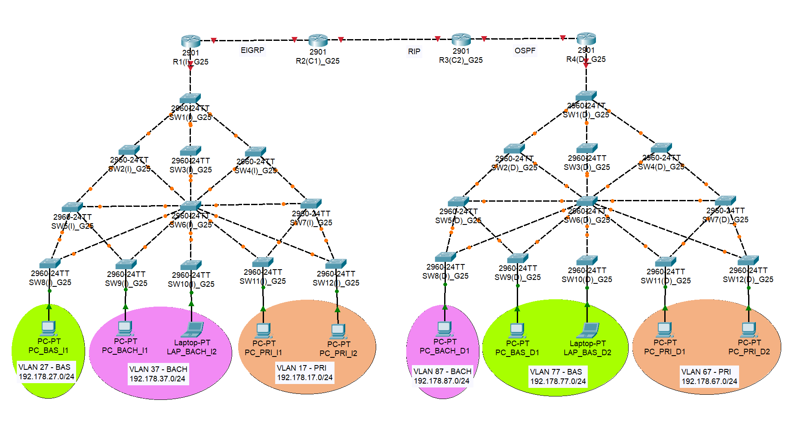

# Práctica 1: Monte Alto y la conectividad

**Universidad San Carlos de Guatemala**  
**Facultad de Ingeniería**  
**Escuela de Ciencias y Sistemas**  
**Curso:** Redes de Computadoras 2  
**Semestre:** Segundo Semestre 2026  
**Grupo:** 25  

### Integrantes

| Carné | Nombre Completo |
|---|---|
| 202201336 | Estuardo Josué Vaquiax Reyes |
| 202004762 | Angel Guillermo Arreaga Barrientos |
| 202203806 | Héctor Daniel Ortiz Osorio |

---

## Tabla de Contenidos

- [1. Descripción](#1-descripción)
- [2. Estado actual del proyecto](#2-estado-actual-del-proyecto)
- [3. Topología implementada](#3-topología-implementada)
  - [3.1 Distribución de los protocolos de enrutamiento](#31-distribución-de-los-protocolos-de-enrutamiento)
  - [3.2 Convención de nombres de los switches](#32-convención-de-nombres-de-los-switches)
- [4. Cálculo del número de grupo](#4-cálculo-del-número-de-grupo)
- [5. Tabla de VLAN y redes](#5-tabla-de-vlan-y-redes)
  - [5.1 Colores utilizados en la topología](#51-colores-utilizados-en-la-topología)
- [6. Direccionamiento de los dispositivos finales](#6-direccionamiento-de-los-dispositivos-finales)
  - [6.1 Edificio izquierdo](#61-edificio-izquierdo)
  - [6.2 Edificio derecho](#62-edificio-derecho)
- [7. Mapa de conexiones](#7-mapa-de-conexiones)
  - [7.1 Enlaces entre routers](#71-enlaces-entre-routers)
  - [7.2 Routers hacia los edificios](#72-routers-hacia-los-edificios)
  - [7.3 Patrón de conexiones entre switches](#73-patrón-de-conexiones-entre-switches)
  - [7.4 Conexiones de los dispositivos finales](#74-conexiones-de-los-dispositivos-finales)
- [8. Configuración básica de switches](#8-configuración-básica-de-switches)
  - [8.1 Hostnames](#81-hostnames)
  - [8.2 Contraseña de los switches VTP Server](#82-contraseña-de-los-switches-vtp-server)
  - [8.3 Dominio VTP](#83-dominio-vtp)
  - [8.4 Configuración del servidor VTP izquierdo](#84-configuración-del-servidor-vtp-izquierdo)
  - [8.5 Configuración del servidor VTP derecho](#85-configuración-del-servidor-vtp-derecho)
  - [8.6 Configuración de los clientes VTP](#86-configuración-de-los-clientes-vtp)
- [9. Configuración de VLAN y enlaces troncales](#9-configuración-de-vlan-y-enlaces-troncales)
  - [9.1 VLAN del edificio izquierdo](#91-vlan-del-edificio-izquierdo)
  - [9.2 VLAN del edificio derecho](#92-vlan-del-edificio-derecho)
  - [9.3 Puertos trunk](#93-puertos-trunk)
  - [9.4 Puertos access](#94-puertos-access)
- [10. Enrutamiento inter-VLAN](#10-enrutamiento-inter-vlan)
  - [10.1 Router del edificio izquierdo](#101-router-del-edificio-izquierdo)
  - [10.2 Router del edificio derecho](#102-router-del-edificio-derecho)
- [11. Spanning Tree Protocol](#11-spanning-tree-protocol)
  - [11.1 PVST — edificio izquierdo](#111-pvst--edificio-izquierdo)
  - [11.2 Rapid PVST — edificio derecho](#112-rapid-pvst--edificio-derecho)
  - [11.3 Tabla de convergencia](#113-tabla-de-convergencia)
  - [11.4 Justificación técnica](#114-justificación-técnica)
- [12. Seguridad de puertos](#12-seguridad-de-puertos)
  - [12.1 Prueba de violación](#121-prueba-de-violación)
- [13. Enrutamiento dinámico](#13-enrutamiento-dinámico)
  - [13.1 EIGRP](#131-eigrp)
  - [13.2 RIP](#132-rip)
  - [13.3 OSPF](#133-ospf)
  - [13.4 Redistribución](#134-redistribución)
- [14. Pruebas de conectividad](#14-pruebas-de-conectividad)
  - [14.1 VLAN Primaria](#141-vlan-primaria)
  - [14.2 VLAN Básicos](#142-vlan-básicos)
  - [14.3 VLAN Bachillerato](#143-vlan-bachillerato)
- [15. Evidencias](#15-evidencias)
- [16. Conclusiones](#16-conclusiones)

---

## 1. Descripción

La práctica consiste en implementar en Cisco Packet Tracer la red LAN del colegio Monte Alto. La solución contempla segmentación por VLAN, administración mediante VTP, enlaces troncales, comunicación inter-VLAN, PVST y Rapid PVST, seguridad de puertos y enrutamiento dinámico con EIGRP, RIP y OSPF.

La topología se replicó siguiendo la estructura indicada en el enunciado:

- 4 routers Cisco 2901.
- 24 switches Cisco 2960-24TT.
- 8 computadoras PC-PT.
- 2 laptops Laptop-PT.
- 2 edificios: izquierdo y derecho.
- 6 VLAN en total.
- Enlaces redundantes entre switches para las pruebas de STP.

---

## 2. Estado actual del proyecto

| Actividad | Estado |
|---|---|
| Creación del archivo `Practica1_G25.pkt` | Completado |
| Colocación de routers, switches y hosts | Completado |
| Nombres visibles de routers, switches y hosts | Completado |
| Cableado completo de la topología | Completado |
| Identificación visual de las VLAN | Completado |
| Configuración IP de PC y laptops | Completado |
| Hostname mediante CLI en los switches | Pendiente |
| Configuración VTP | Pendiente |
| Configuración de enlaces trunk y access | Pendiente |
| Creación y propagación de VLAN | Pendiente |
| Enrutamiento inter-VLAN | Pendiente |
| PVST en el edificio izquierdo | Pendiente |
| Rapid PVST en el edificio derecho | Pendiente |
| Port-security en la VLAN Básicos | Pendiente |
| EIGRP, RIP y OSPF | Pendiente |
| Redistribución de rutas | Pendiente |
| Pruebas de conectividad | Pendiente |
| Pruebas de convergencia | Pendiente |
| Conclusiones | Pendiente |

---

## 3. Topología implementada



### 3.1 Distribución de los protocolos de enrutamiento

```text
R1(I)_G25 ── EIGRP ── R2(C1)_G25 ── RIP ── R3(C2)_G25 ── OSPF ── R4(D)_G25
```

- `R1(I)_G25`: router del edificio izquierdo.
- `R2(C1)_G25`: primer router central.
- `R3(C2)_G25`: segundo router central.
- `R4(D)_G25`: router del edificio derecho.

### 3.2 Convención de nombres de los switches

Los nombres visibles se organizaron por edificio:

```text
SW1(I)_G25 ... SW12(I)_G25
SW1(D)_G25 ... SW12(D)_G25
```

Para la configuración mediante CLI se utilizarán hostnames sin paréntesis:

```text
SW1I_G25 ... SW12I_G25
SW1D_G25 ... SW12D_G25
```

---

## 4. Cálculo del número de grupo

El grupo asignado es el número `25`. Para los cálculos que requieren un único dígito:

```text
2 + 5 = 7
```

Por lo tanto, el valor utilizado para calcular las VLAN y las redes dinámicas es `7`.

---

## 5. Tabla de VLAN y redes

| Edificio | Área | VLAN | Nombre sugerido | Red | Gateway |
|---|---|---:|---|---|---|
| Izquierdo | Primaria | 17 | `PRIMARIA_I` | `192.178.17.0/24` | `192.178.17.1` |
| Izquierdo | Básicos | 27 | `BASICOS_I` | `192.178.27.0/24` | `192.178.27.1` |
| Izquierdo | Bachillerato | 37 | `BACHILLERATO_I` | `192.178.37.0/24` | `192.178.37.1` |
| Derecho | Primaria | 67 | `PRIMARIA_D` | `192.178.67.0/24` | `192.178.67.1` |
| Derecho | Básicos | 77 | `BASICOS_D` | `192.178.77.0/24` | `192.178.77.1` |
| Derecho | Bachillerato | 87 | `BACHILLERATO_D` | `192.178.87.0/24` | `192.178.87.1` |

### 5.1 Colores utilizados en la topología

| Área | Color hexadecimal |
|---|---|
| Primaria | `#F4B183` |
| Básicos | `#A8FF00` |
| Bachillerato | `#F28AF4` |
| Texto | `#000000` |

---

## 6. Direccionamiento de los dispositivos finales

### 6.1 Edificio izquierdo

| Dispositivo | VLAN | Dirección IP | Máscara | Gateway |
|---|---:|---|---|---|
| `PC_BAS_I1` | 27 | `192.178.27.10` | `255.255.255.0` | `192.178.27.1` |
| `PC_BACH_I1` | 37 | `192.178.37.10` | `255.255.255.0` | `192.178.37.1` |
| `LAP_BACH_I2` | 37 | `192.178.37.11` | `255.255.255.0` | `192.178.37.1` |
| `PC_PRI_I1` | 17 | `192.178.17.10` | `255.255.255.0` | `192.178.17.1` |
| `PC_PRI_I2` | 17 | `192.178.17.11` | `255.255.255.0` | `192.178.17.1` |

### 6.2 Edificio derecho

| Dispositivo | VLAN | Dirección IP | Máscara | Gateway |
|---|---:|---|---|---|
| `PC_BACH_D1` | 87 | `192.178.87.10` | `255.255.255.0` | `192.178.87.1` |
| `PC_BAS_D1` | 77 | `192.178.77.10` | `255.255.255.0` | `192.178.77.1` |
| `LAP_BAS_D2` | 77 | `192.178.77.11` | `255.255.255.0` | `192.178.77.1` |
| `PC_PRI_D1` | 67 | `192.178.67.10` | `255.255.255.0` | `192.178.67.1` |
| `PC_PRI_D2` | 67 | `192.178.67.11` | `255.255.255.0` | `192.178.67.1` |

---

## 7. Mapa de conexiones

### 7.1 Enlaces entre routers

| Desde | Puerto | Hacia | Puerto | Protocolo |
|---|---|---|---|---|
| `R1(I)_G25` | `G0/1` | `R2(C1)_G25` | `G0/1` | EIGRP |
| `R2(C1)_G25` | `G0/0` | `R3(C2)_G25` | `G0/0` | RIP |
| `R3(C2)_G25` | `G0/1` | `R4(D)_G25` | `G0/1` | OSPF |

### 7.2 Routers hacia los edificios

| Router | Puerto | Switch | Puerto |
|---|---|---|---|
| `R1(I)_G25` | `G0/0` | `SW1(I)_G25` | `G0/1` |
| `R4(D)_G25` | `G0/0` | `SW1(D)_G25` | `G0/1` |

### 7.3 Patrón de conexiones entre switches

El siguiente patrón se aplicó de manera idéntica en ambos edificios. La letra `X` representa `I` para el edificio izquierdo y `D` para el derecho.

| Desde | Puerto | Hacia | Puerto |
|---|---|---|---|
| `SW1(X)_G25` | `Fa0/1` | `SW2(X)_G25` | `Fa0/1` |
| `SW1(X)_G25` | `Fa0/2` | `SW3(X)_G25` | `Fa0/1` |
| `SW1(X)_G25` | `Fa0/3` | `SW4(X)_G25` | `Fa0/1` |
| `SW2(X)_G25` | `Fa0/2` | `SW5(X)_G25` | `Fa0/1` |
| `SW2(X)_G25` | `Fa0/3` | `SW6(X)_G25` | `Fa0/1` |
| `SW3(X)_G25` | `Fa0/2` | `SW6(X)_G25` | `Fa0/2` |
| `SW4(X)_G25` | `Fa0/2` | `SW6(X)_G25` | `Fa0/3` |
| `SW4(X)_G25` | `Fa0/3` | `SW7(X)_G25` | `Fa0/1` |
| `SW5(X)_G25` | `Fa0/2` | `SW6(X)_G25` | `Fa0/4` |
| `SW6(X)_G25` | `Fa0/5` | `SW7(X)_G25` | `Fa0/2` |
| `SW5(X)_G25` | `Fa0/3` | `SW8(X)_G25` | `Fa0/1` |
| `SW5(X)_G25` | `Fa0/4` | `SW9(X)_G25` | `Fa0/1` |
| `SW6(X)_G25` | `Fa0/6` | `SW8(X)_G25` | `Fa0/2` |
| `SW6(X)_G25` | `Fa0/7` | `SW9(X)_G25` | `Fa0/2` |
| `SW6(X)_G25` | `Fa0/8` | `SW10(X)_G25` | `Fa0/1` |
| `SW6(X)_G25` | `Fa0/9` | `SW11(X)_G25` | `Fa0/1` |
| `SW6(X)_G25` | `Fa0/10` | `SW12(X)_G25` | `Fa0/1` |
| `SW7(X)_G25` | `Fa0/3` | `SW11(X)_G25` | `Fa0/2` |
| `SW7(X)_G25` | `Fa0/4` | `SW12(X)_G25` | `Fa0/2` |

> El puerto `Fa0/2` de `SW10(I)_G25` y `SW10(D)_G25` queda libre porque cada uno posee un enlace ascendente a `SW6` y un enlace de acceso hacia una laptop.

### 7.4 Conexiones de los dispositivos finales

#### Edificio izquierdo

| Switch | Puerto | Dispositivo | Puerto |
|---|---|---|---|
| `SW8(I)_G25` | `Fa0/3` | `PC_BAS_I1` | `Fa0` |
| `SW9(I)_G25` | `Fa0/3` | `PC_BACH_I1` | `Fa0` |
| `SW10(I)_G25` | `Fa0/3` | `LAP_BACH_I2` | `Fa0` |
| `SW11(I)_G25` | `Fa0/3` | `PC_PRI_I1` | `Fa0` |
| `SW12(I)_G25` | `Fa0/3` | `PC_PRI_I2` | `Fa0` |

#### Edificio derecho

| Switch | Puerto | Dispositivo | Puerto |
|---|---|---|---|
| `SW8(D)_G25` | `Fa0/3` | `PC_BACH_D1` | `Fa0` |
| `SW9(D)_G25` | `Fa0/3` | `PC_BAS_D1` | `Fa0` |
| `SW10(D)_G25` | `Fa0/3` | `LAP_BAS_D2` | `Fa0` |
| `SW11(D)_G25` | `Fa0/3` | `PC_PRI_D1` | `Fa0` |
| `SW12(D)_G25` | `Fa0/3` | `PC_PRI_D2` | `Fa0` |

---

## 8. Configuración básica de switches

> Esta sección se completará conforme se configuren los dispositivos.

### 8.1 Hostnames

Formato requerido:

```text
SW#A_G#B
```

Convención utilizada en la práctica:

```text
SW1I_G25 ... SW12I_G25
SW1D_G25 ... SW12D_G25
```

### 8.2 Contraseña de los switches VTP Server

```cisco
enable secret redes2grupo25
```

### 8.3 Dominio VTP

```text
G25
```

### 8.4 Configuración del servidor VTP izquierdo

```cisco
! Pendiente de ejecutar y documentar
```

### 8.5 Configuración del servidor VTP derecho

```cisco
! Pendiente de ejecutar y documentar
```

### 8.6 Configuración de los clientes VTP

```cisco
! Pendiente de ejecutar y documentar
```

---

## 9. Configuración de VLAN y enlaces troncales

### 9.1 VLAN del edificio izquierdo

```cisco
! Pendiente de ejecutar y documentar
```

### 9.2 VLAN del edificio derecho

```cisco
! Pendiente de ejecutar y documentar
```

### 9.3 Puertos trunk

```cisco
! Pendiente de ejecutar y documentar
```

### 9.4 Puertos access

```cisco
! Pendiente de ejecutar y documentar
```

---

## 10. Enrutamiento inter-VLAN

### 10.1 Router del edificio izquierdo

```cisco
! Pendiente de ejecutar y documentar
```

### 10.2 Router del edificio derecho

```cisco
! Pendiente de ejecutar y documentar
```

---

## 11. Spanning Tree Protocol

### 11.1 PVST — edificio izquierdo

- Switch raíz: _Pendiente_
- Puertos forwarding: _Pendiente_
- Puertos blocked: _Pendiente_

```cisco
! Pendiente de ejecutar y documentar
```

### 11.2 Rapid PVST — edificio derecho

- Switch raíz: _Pendiente_
- Puertos forwarding: _Pendiente_
- Puertos blocked: _Pendiente_

```cisco
! Pendiente de ejecutar y documentar
```

### 11.3 Tabla de convergencia

| Protocolo | Edificio | Enlace desconectado | Tiempo de convergencia | Observaciones |
|---|---|---|---:|---|
| PVST | Izquierdo | _Pendiente_ | _Pendiente_ | _Pendiente_ |
| Rapid PVST | Derecho | _Pendiente_ | _Pendiente_ | _Pendiente_ |

### 11.4 Justificación técnica

_Pendiente de redactar con base en los tiempos medidos._

---

## 12. Seguridad de puertos

La configuración de port-security se aplicará en todos los puertos de acceso conectados a dispositivos de la VLAN Básicos.

Requisitos:

- Máximo una dirección MAC.
- Aprendizaje o asignación de la MAC autorizada.
- Modo de violación `shutdown`.
- Evidencia del puerto en estado `err-disabled` al conectar una MAC no autorizada.

```cisco
! Pendiente de ejecutar y documentar
```

### 12.1 Prueba de violación

| Dispositivo | Switch/puerto | MAC autorizada | Resultado con MAC no autorizada |
|---|---|---|---|
| `PC_BAS_I1` | `SW8(I)_G25 Fa0/3` | _Pendiente_ | _Pendiente_ |
| `PC_BAS_D1` | `SW9(D)_G25 Fa0/3` | _Pendiente_ | _Pendiente_ |
| `LAP_BAS_D2` | `SW10(D)_G25 Fa0/3` | _Pendiente_ | _Pendiente_ |

---

## 13. Enrutamiento dinámico

Para el valor reducido del grupo `7`, las redes indicadas son:

| Protocolo | Ubicación | Cálculo | Red |
|---|---|---|---|
| OSPF | Sector derecho | `1 + 7 = 8` | `10.10.8.0/24` |
| RIP | Sector central | `2 + 7 = 9` | `10.10.9.0/24` |
| EIGRP | Sector izquierdo | `3 + 7 = 10` | `10.10.10.0/24` |

### 13.1 EIGRP

```cisco
! Pendiente de ejecutar y documentar
```

### 13.2 RIP

```cisco
! Pendiente de ejecutar y documentar
```

### 13.3 OSPF

```cisco
! Pendiente de ejecutar y documentar
```

### 13.4 Redistribución

```cisco
! Pendiente de ejecutar y documentar
```

---

## 14. Pruebas de conectividad

### 14.1 VLAN Primaria

| Prueba | Origen | Destino | Resultado |
|---|---|---|---|
| Mismo edificio | _Pendiente_ | _Pendiente_ | _Pendiente_ |
| Entre edificios | _Pendiente_ | _Pendiente_ | _Pendiente_ |
| Inter-VLAN | _Pendiente_ | _Pendiente_ | _Pendiente_ |

### 14.2 VLAN Básicos

| Prueba | Origen | Destino | Resultado |
|---|---|---|---|
| Mismo edificio | _Pendiente_ | _Pendiente_ | _Pendiente_ |
| Entre edificios | _Pendiente_ | _Pendiente_ | _Pendiente_ |
| Inter-VLAN | _Pendiente_ | _Pendiente_ | _Pendiente_ |

### 14.3 VLAN Bachillerato

| Prueba | Origen | Destino | Resultado |
|---|---|---|---|
| Mismo edificio | _Pendiente_ | _Pendiente_ | _Pendiente_ |
| Entre edificios | _Pendiente_ | _Pendiente_ | _Pendiente_ |
| Inter-VLAN | _Pendiente_ | _Pendiente_ | _Pendiente_ |

---

## 15. Evidencias

Agregar las capturas dentro de la carpeta `assets/images/` y referenciarlas de la siguiente manera:

```markdown

```

Capturas mínimas recomendadas:

1. Topología completa.
2. Estado VTP del servidor.
3. Propagación de VLAN en un cliente.
4. Interfaces trunk.
5. Tabla de VLAN.
6. Estado de PVST y Rapid PVST.
7. Pruebas de convergencia.
8. Port-security y violación de seguridad.
9. Tablas de enrutamiento.
10. Vecinos EIGRP y OSPF.
11. Pruebas de ping.

---

## 16. Conclusiones

1. _Pendiente._
2. _Pendiente._
3. _Pendiente._

---
