# Práctica 1: Monte Alto y la conectividad

**Universidad San Carlos de Guatemala**  
**Facultad de Ingeniería**  
**Escuela de Ciencias y Sistemas**  
**Curso:** Redes de Computadoras 2  
**Semestre:** Segundo Semestre 2026  
**Grupo:** 25  

### Integrantes

| Carné | Nombre Completo |
|---|---|
| 202201336 | Estuardo Josué Vaquiax Reyes |
| 202004762 | Angel Guillermo Arreaga Barrientos |
| 202203806 | Héctor Daniel Ortiz Osorio |

---

## Tabla de Contenidos

- [1. Descripción](#1-descripción)
- [2. Estado actual del proyecto](#2-estado-actual-del-proyecto)
- [3. Topología implementada](#3-topología-implementada)
  - [3.1 Distribución de los protocolos de enrutamiento](#31-distribución-de-los-protocolos-de-enrutamiento)
  - [3.2 Convención de nombres de los switches](#32-convención-de-nombres-de-los-switches)
- [4. Cálculo del número de grupo](#4-cálculo-del-número-de-grupo)
- [5. Tabla de VLAN y redes](#5-tabla-de-vlan-y-redes)
  - [5.1 Colores utilizados en la topología](#51-colores-utilizados-en-la-topología)
- [6. Direccionamiento de los dispositivos finales](#6-direccionamiento-de-los-dispositivos-finales)
  - [6.1 Edificio izquierdo](#61-edificio-izquierdo)
  - [6.2 Edificio derecho](#62-edificio-derecho)
- [7. Mapa de conexiones](#7-mapa-de-conexiones)
  - [7.1 Enlaces entre routers](#71-enlaces-entre-routers)
  - [7.2 Routers hacia los edificios](#72-routers-hacia-los-edificios)
  - [7.3 Patrón de conexiones entre switches](#73-patrón-de-conexiones-entre-switches)
  - [7.4 Conexiones de los dispositivos finales](#74-conexiones-de-los-dispositivos-finales)
- [8. Configuración básica de switches](#8-configuración-básica-de-switches)
  - [8.1 Hostnames](#81-hostnames)
  - [8.2 Contraseña de los switches VTP Server](#82-contraseña-de-los-switches-vtp-server)
  - [8.3 Dominio VTP](#83-dominio-vtp)
  - [8.4 Configuración del servidor VTP izquierdo](#84-configuración-del-servidor-vtp-izquierdo)
  - [8.5 Configuración del servidor VTP derecho](#85-configuración-del-servidor-vtp-derecho)
  - [8.6 Configuración de los clientes VTP](#86-configuración-de-los-clientes-vtp)
- [9. Configuración de VLAN y enlaces troncales](#9-configuración-de-vlan-y-enlaces-troncales)
  - [9.1 VLAN del edificio izquierdo](#91-vlan-del-edificio-izquierdo)
  - [9.2 VLAN del edificio derecho](#92-vlan-del-edificio-derecho)
  - [9.3 Puertos trunk](#93-puertos-trunk)
  - [9.4 Puertos access](#94-puertos-access)
- [10. Enrutamiento inter-VLAN](#10-enrutamiento-inter-vlan)
  - [10.1 Router del edificio izquierdo](#101-router-del-edificio-izquierdo)
  - [10.2 Router del edificio derecho](#102-router-del-edificio-derecho)
- [11. Spanning Tree Protocol](#11-spanning-tree-protocol)
  - [11.1 PVST — edificio izquierdo](#111-pvst--edificio-izquierdo)
  - [11.2 Rapid PVST — edificio derecho](#112-rapid-pvst--edificio-derecho)
  - [11.3 Tabla de convergencia](#113-tabla-de-convergencia)
  - [11.4 Justificación técnica](#114-justificación-técnica)
- [12. Seguridad de puertos](#12-seguridad-de-puertos)
  - [12.1 Prueba de violación](#121-prueba-de-violación)
- [13. Enrutamiento dinámico](#13-enrutamiento-dinámico)
  - [13.1 EIGRP](#131-eigrp)
  - [13.2 RIP](#132-rip)
  - [13.3 OSPF](#133-ospf)
  - [13.4 Redistribución](#134-redistribución)
- [14. Pruebas de conectividad](#14-pruebas-de-conectividad)
  - [14.1 VLAN Primaria](#141-vlan-primaria)
  - [14.2 VLAN Básicos](#142-vlan-básicos)
  - [14.3 VLAN Bachillerato](#143-vlan-bachillerato)
- [15. Evidencias](#15-evidencias)
- [16. Conclusiones](#16-conclusiones)

---

## 1. Descripción

La práctica consiste en implementar en Cisco Packet Tracer la red LAN del colegio Monte Alto. La solución contempla segmentación por VLAN, administración mediante VTP, enlaces troncales, comunicación inter-VLAN, PVST y Rapid PVST, seguridad de puertos y enrutamiento dinámico con EIGRP, RIP y OSPF.

La topología se replicó siguiendo la estructura indicada en el enunciado:

- 4 routers Cisco 2901.
- 24 switches Cisco 2960-24TT.
- 8 computadoras PC-PT.
- 2 laptops Laptop-PT.
- 2 edificios: izquierdo y derecho.
- 6 VLAN en total.
- Enlaces redundantes entre switches para las pruebas de STP.

---

## 2. Estado actual del proyecto

| Actividad | Estado |
|---|---|
| Creación del archivo `Practica1_G25.pkt` | Completado |
| Colocación de routers, switches y hosts | Completado |
| Nombres visibles de routers, switches y hosts | Completado |
| Cableado completo de la topología | Completado |
| Identificación visual de las VLAN | Completado |
| Configuración IP de PC y laptops | Completado |
| Hostname mediante CLI en los switches | Completado |
| Configuración VTP | Completado |
| Configuración de enlaces trunk y access | Completado |
| Creación y propagación de VLAN | Completado |
| Enrutamiento inter-VLAN | Completado |
| PVST en el edificio izquierdo | Completado |
| Rapid PVST en el edificio derecho | Completado |
| Port-security en la VLAN Básicos | Completado |
| EIGRP, RIP y OSPF | Completado |
| Redistribución de rutas | Completado |
| Pruebas de conectividad | Completado |
| Pruebas de convergencia | Completado |
| Conclusiones | Completado |

---

## 3. Topología implementada

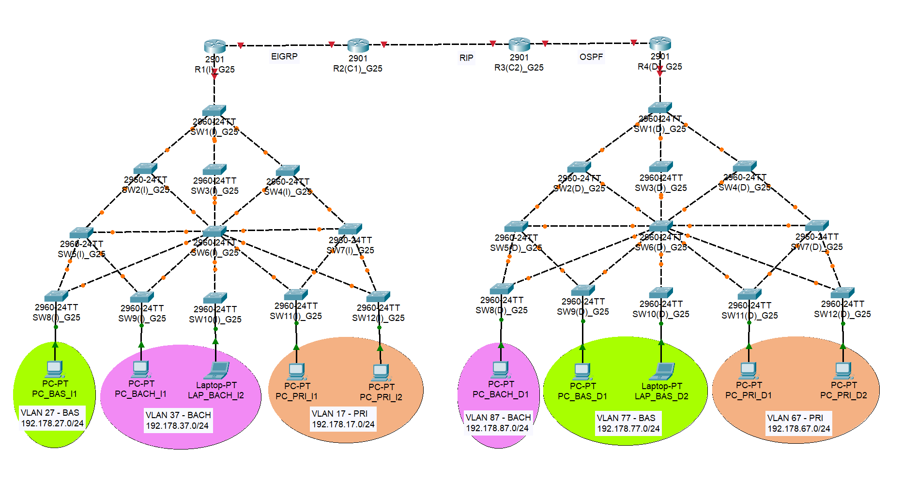

### 3.1 Distribución de los protocolos de enrutamiento

```text
R1(I)_G25 ── EIGRP ── R2(C1)_G25 ── RIP ── R3(C2)_G25 ── OSPF ── R4(D)_G25
```

- `R1(I)_G25`: router del edificio izquierdo.
- `R2(C1)_G25`: primer router central.
- `R3(C2)_G25`: segundo router central.
- `R4(D)_G25`: router del edificio derecho.

### 3.2 Convención de nombres de los switches

Los nombres visibles se organizaron por edificio:

```text
SW1(I)_G25 ... SW12(I)_G25
SW1(D)_G25 ... SW12(D)_G25
```

Para la configuración mediante CLI se utilizarán hostnames sin paréntesis:

```text
SW1I_G25 ... SW12I_G25
SW1D_G25 ... SW12D_G25
```

---

## 4. Cálculo del número de grupo

El grupo asignado es el número `25`. Para los cálculos que requieren un único dígito:

```text
2 + 5 = 7
```

Por lo tanto, el valor utilizado para calcular las VLAN y las redes dinámicas es `7`.

---

## 5. Tabla de VLAN y redes

| Edificio | Área | VLAN | Nombre sugerido | Red | Gateway |
|---|---|---:|---|---|---|
| Izquierdo | Primaria | 17 | `PRIMARIA_I` | `192.178.17.0/24` | `192.178.17.1` |
| Izquierdo | Básicos | 27 | `BASICOS_I` | `192.178.27.0/24` | `192.178.27.1` |
| Izquierdo | Bachillerato | 37 | `BACHILLERATO_I` | `192.178.37.0/24` | `192.178.37.1` |
| Derecho | Primaria | 67 | `PRIMARIA_D` | `192.178.67.0/24` | `192.178.67.1` |
| Derecho | Básicos | 77 | `BASICOS_D` | `192.178.77.0/24` | `192.178.77.1` |
| Derecho | Bachillerato | 87 | `BACHILLERATO_D` | `192.178.87.0/24` | `192.178.87.1` |

### 5.1 Colores utilizados en la topología

| Área | Color hexadecimal |
|---|---|
| Primaria | `#F4B183` |
| Básicos | `#A8FF00` |
| Bachillerato | `#F28AF4` |
| Texto | `#000000` |

---

## 6. Direccionamiento de los dispositivos finales

### 6.1 Edificio izquierdo

| Dispositivo | VLAN | Dirección IP | Máscara | Gateway |
|---|---:|---|---|---|
| `PC_BAS_I1` | 27 | `192.178.27.10` | `255.255.255.0` | `192.178.27.1` |
| `PC_BACH_I1` | 37 | `192.178.37.10` | `255.255.255.0` | `192.178.37.1` |
| `LAP_BACH_I2` | 37 | `192.178.37.11` | `255.255.255.0` | `192.178.37.1` |
| `PC_PRI_I1` | 17 | `192.178.17.10` | `255.255.255.0` | `192.178.17.1` |
| `PC_PRI_I2` | 17 | `192.178.17.11` | `255.255.255.0` | `192.178.17.1` |

### 6.2 Edificio derecho

| Dispositivo | VLAN | Dirección IP | Máscara | Gateway |
|---|---:|---|---|---|
| `PC_BACH_D1` | 87 | `192.178.87.10` | `255.255.255.0` | `192.178.87.1` |
| `PC_BAS_D1` | 77 | `192.178.77.10` | `255.255.255.0` | `192.178.77.1` |
| `LAP_BAS_D2` | 77 | `192.178.77.11` | `255.255.255.0` | `192.178.77.1` |
| `PC_PRI_D1` | 67 | `192.178.67.10` | `255.255.255.0` | `192.178.67.1` |
| `PC_PRI_D2` | 67 | `192.178.67.11` | `255.255.255.0` | `192.178.67.1` |

---

## 7. Mapa de conexiones

### 7.1 Enlaces entre routers

| Desde | Puerto | Hacia | Puerto | Protocolo |
|---|---|---|---|---|
| `R1(I)_G25` | `G0/1` | `R2(C1)_G25` | `G0/1` | EIGRP |
| `R2(C1)_G25` | `G0/0` | `R3(C2)_G25` | `G0/0` | RIP |
| `R3(C2)_G25` | `G0/1` | `R4(D)_G25` | `G0/1` | OSPF |

### 7.2 Routers hacia los edificios

| Router | Puerto | Switch | Puerto |
|---|---|---|---|
| `R1(I)_G25` | `G0/0` | `SW1(I)_G25` | `G0/1` |
| `R4(D)_G25` | `G0/0` | `SW1(D)_G25` | `G0/1` |

### 7.3 Patrón de conexiones entre switches

El siguiente patrón se aplicó de manera idéntica en ambos edificios. La letra `X` representa `I` para el edificio izquierdo y `D` para el derecho.

| Desde | Puerto | Hacia | Puerto |
|---|---|---|---|
| `SW1(X)_G25` | `Fa0/1` | `SW2(X)_G25` | `Fa0/1` |
| `SW1(X)_G25` | `Fa0/2` | `SW3(X)_G25` | `Fa0/1` |
| `SW1(X)_G25` | `Fa0/3` | `SW4(X)_G25` | `Fa0/1` |
| `SW2(X)_G25` | `Fa0/2` | `SW5(X)_G25` | `Fa0/1` |
| `SW2(X)_G25` | `Fa0/3` | `SW6(X)_G25` | `Fa0/1` |
| `SW3(X)_G25` | `Fa0/2` | `SW6(X)_G25` | `Fa0/2` |
| `SW4(X)_G25` | `Fa0/2` | `SW6(X)_G25` | `Fa0/3` |
| `SW4(X)_G25` | `Fa0/3` | `SW7(X)_G25` | `Fa0/1` |
| `SW5(X)_G25` | `Fa0/2` | `SW6(X)_G25` | `Fa0/4` |
| `SW6(X)_G25` | `Fa0/5` | `SW7(X)_G25` | `Fa0/2` |
| `SW5(X)_G25` | `Fa0/3` | `SW8(X)_G25` | `Fa0/1` |
| `SW5(X)_G25` | `Fa0/4` | `SW9(X)_G25` | `Fa0/1` |
| `SW6(X)_G25` | `Fa0/6` | `SW8(X)_G25` | `Fa0/2` |
| `SW6(X)_G25` | `Fa0/7` | `SW9(X)_G25` | `Fa0/2` |
| `SW6(X)_G25` | `Fa0/8` | `SW10(X)_G25` | `Fa0/1` |
| `SW6(X)_G25` | `Fa0/9` | `SW11(X)_G25` | `Fa0/1` |
| `SW6(X)_G25` | `Fa0/10` | `SW12(X)_G25` | `Fa0/1` |
| `SW7(X)_G25` | `Fa0/3` | `SW11(X)_G25` | `Fa0/2` |
| `SW7(X)_G25` | `Fa0/4` | `SW12(X)_G25` | `Fa0/2` |

> El puerto `Fa0/2` de `SW10(I)_G25` y `SW10(D)_G25` queda libre porque cada uno posee un enlace ascendente a `SW6` y un enlace de acceso hacia una laptop.

### 7.4 Conexiones de los dispositivos finales

#### Edificio izquierdo

| Switch | Puerto | Dispositivo | Puerto |
|---|---|---|---|
| `SW8(I)_G25` | `Fa0/3` | `PC_BAS_I1` | `Fa0` |
| `SW9(I)_G25` | `Fa0/3` | `PC_BACH_I1` | `Fa0` |
| `SW10(I)_G25` | `Fa0/3` | `LAP_BACH_I2` | `Fa0` |
| `SW11(I)_G25` | `Fa0/3` | `PC_PRI_I1` | `Fa0` |
| `SW12(I)_G25` | `Fa0/3` | `PC_PRI_I2` | `Fa0` |

#### Edificio derecho

| Switch | Puerto | Dispositivo | Puerto |
|---|---|---|---|
| `SW8(D)_G25` | `Fa0/3` | `PC_BACH_D1` | `Fa0` |
| `SW9(D)_G25` | `Fa0/3` | `PC_BAS_D1` | `Fa0` |
| `SW10(D)_G25` | `Fa0/3` | `LAP_BAS_D2` | `Fa0` |
| `SW11(D)_G25` | `Fa0/3` | `PC_PRI_D1` | `Fa0` |
| `SW12(D)_G25` | `Fa0/3` | `PC_PRI_D2` | `Fa0` |

---

## 8. Configuración básica de switches

### 8.1 Hostnames

Formato requerido:

```text
SW#A_G#B
```

Convención utilizada en la práctica:

```text
SW1I_G25 ... SW12I_G25
SW1D_G25 ... SW12D_G25
```

### 8.2 Contraseña de los switches VTP Server

```cisco
enable secret redes2grupo25
```

### 8.3 Dominio VTP

```text
G25
```

### 8.4 Configuración del servidor VTP izquierdo

`SW1I_G25` es el servidor VTP y la raíz de PVST del edificio izquierdo.

```cisco
enable
configure terminal
hostname SW1I_G25
enable secret redes2grupo25
vtp mode server
vtp domain G25
end
```

### 8.5 Configuración del servidor VTP derecho

`SW1D_G25` es el servidor VTP y la raíz de Rapid PVST del edificio derecho.

```cisco
enable
configure terminal
hostname SW1D_G25
enable secret redes2grupo25
vtp mode server
vtp domain G25
end
```

### 8.6 Configuración de los clientes VTP

El resto de switches de cada edificio (`SW2` a `SW12`, tanto `I` como `D`) se configuraron en modo cliente VTP, apuntando al mismo dominio `G25` para recibir la base de datos de VLAN desde el servidor correspondiente.

```cisco
enable
configure terminal
hostname SW[NUM][X]_G25
vtp mode client
vtp domain G25
end
```

> Sustituir `[NUM]` por el número de switch (2 al 12) y `[X]` por `I` o `D` según el edificio.

---

## 9. Configuración de VLAN y enlaces troncales

### 9.1 VLAN del edificio izquierdo

Las VLAN se crean únicamente en el servidor VTP (`SW1I_G25`) y se propagan por VTP al resto de switches clientes del edificio.

```cisco
configure terminal
vlan 17
name PRIMARIA_I
vlan 27
name BASICOS_I
vlan 37
name BACHILLERATO_I
exit
```

### 9.2 VLAN del edificio derecho

Creadas en el servidor VTP `SW1D_G25`.

```cisco
configure terminal
vlan 67
name PRIMARIA_D
vlan 77
name BASICOS_D
vlan 87
name BACHILLERATO_D
exit
```

### 9.3 Puertos trunk

En `SW1` a `SW7` de cada edificio (switches de distribución/núcleo, sin dispositivos finales conectados) todos los puertos utilizados se configuraron como trunk:

```cisco
interface range G0/1-2, Fa0/1-24
switchport mode trunk
exit
```

En `SW8` a `SW12` de cada edificio (switches de acceso) se dejó como trunk todo el rango excepto el puerto `Fa0/3`, reservado para el dispositivo final:

```cisco
interface range G0/1-2, Fa0/1-2, Fa0/4-24
switchport mode trunk
exit
```

### 9.4 Puertos access

El puerto `Fa0/3` de cada switch de acceso se configuró en modo access, asignado a la VLAN correspondiente al área.

**Edificio izquierdo**

```cisco
! SW8I_G25 - Básicos (VLAN 27)
interface Fa0/3
switchport mode access
switchport access vlan 27
exit

! SW9I_G25 y SW10I_G25 - Bachillerato (VLAN 37)
interface Fa0/3
switchport mode access
switchport access vlan 37
exit

! SW11I_G25 y SW12I_G25 - Primaria (VLAN 17)
interface Fa0/3
switchport mode access
switchport access vlan 17
exit
```

**Edificio derecho**

```cisco
! SW8D_G25 - Bachillerato (VLAN 87)
interface Fa0/3
switchport mode access
switchport access vlan 87
exit

! SW9D_G25 y SW10D_G25 - Básicos (VLAN 77)
interface Fa0/3
switchport mode access
switchport access vlan 77
exit

! SW11D_G25 y SW12D_G25 - Primaria (VLAN 67)
interface Fa0/3
switchport mode access
switchport access vlan 67
exit
```

> Los puertos access de `SW8I_G25`, `SW9D_G25` y `SW10D_G25` (VLAN Básicos) llevan además la configuración de port-security detallada en la [sección 12](#12-seguridad-de-puertos).

---

## 10. Enrutamiento inter-VLAN

Se utilizó *router-on-a-stick* con subinterfaces sobre `G0/0` de cada router de edificio.

### 10.1 Router del edificio izquierdo

```cisco
enable
configure terminal
hostname R1I_G25
interface G0/0
no shutdown
exit
interface G0/0.17
encapsulation dot1Q 17
ip address 192.178.17.1 255.255.255.0
exit
interface G0/0.27
encapsulation dot1Q 27
ip address 192.178.27.1 255.255.255.0
exit
interface G0/0.37
encapsulation dot1Q 37
ip address 192.178.37.1 255.255.255.0
exit
```

### 10.2 Router del edificio derecho

```cisco
enable
configure terminal
hostname R4D_G25
interface G0/0
no shutdown
exit
interface G0/0.67
encapsulation dot1Q 67
ip address 192.178.67.1 255.255.255.0
exit
interface G0/0.77
encapsulation dot1Q 77
ip address 192.178.77.1 255.255.255.0
exit
interface G0/0.87
encapsulation dot1Q 87
ip address 192.178.87.1 255.255.255.0
exit
```

---

## 11. Spanning Tree Protocol

### 11.1 PVST — edificio izquierdo

- Switch raíz: `SW1I_G25` (identificado en `show spanning-tree vlan 17` desde `SW6I_G25`: Root ID Priority 24593, Address 0001.C77E.9B5C, coincidiendo con la configuración `root primary` aplicada).
- Puertos forwarding (vistos desde `SW6I_G25`, switch intermedio): `Fa0/2` (Root, hacia SW1I_G25) y `Fa0/4`, `Fa0/6`, `Fa0/7`, `Fa0/8`, `Fa0/9`, `Fa0/10` (Designados, hacia switches de abajo).
- Puertos blocked (vistos desde `SW6I_G25`): `Fa0/1`, `Fa0/3` y `Fa0/5` (en `Altn BLK` — enlaces redundantes bloqueados para evitar loops).

```cisco
configure terminal
spanning-tree mode pvst
spanning-tree vlan 17,27,37 root primary
exit
```

### 11.2 Rapid PVST — edificio derecho

- Switch raíz: `SW1D_G25` (confirmado con `show spanning-tree vlan 67`: *"This bridge is the root"*, Priority 24643, Address 0004.9A75.2540). Todos sus puertos activos (`Fa0/1`, `Fa0/2`, `Fa0/3`, `Gi0/1`) están en `Desg FWD`.
- Puertos forwarding (vistos desde `SW6D_G25`, switch intermedio): `Fa0/2` (Root, hacia SW1D_G25) y `Fa0/4`, `Fa0/5`, `Fa0/6`, `Fa0/7`, `Fa0/8`, `Fa0/9`, `Fa0/10` (Designados, hacia switches de acceso).
- Puertos blocked (vistos desde `SW6D_G25`): `Fa0/1` y `Fa0/3` (en `Altn BLK` — enlaces redundantes bloqueados para evitar loops).

```cisco
configure terminal
spanning-tree mode rapid-pvst
spanning-tree vlan 67,77,87 root primary
exit
```

### 11.3 Tabla de convergencia

| Protocolo | Edificio | Enlace desconectado | Tiempo de convergencia | Observaciones |
|---|---|---|---:|---|
| PVST | Izquierdo | `SW6I_G25 Fa0/2 — SW3I_G25 Fa0/2` | ~30 seg | El puerto `Fa0/3` pasó a `Root`, transitando por `LSN` y `LRN` antes de llegar a `FWD`. Confirmado con `show spanning-tree vlan 17` en `SW6I_G25`. |
| Rapid PVST | Derecho | `SW6D_G25 Fa0/2 — SW3D_G25 Fa0/2` | ~2 seg | El puerto alterno pasó a `Root/FWD` casi de inmediato, gracias al mecanismo de propuesta/acuerdo de 802.1w, sin pasar visiblemente por los estados de espera de PVST. |

### 11.4 Justificación técnica

Los resultados obtenidos confirman la diferencia teórica entre ambos protocolos. En el edificio izquierdo, bajo PVST (802.1D), la convergencia tomó aproximadamente **30 segundos**. Esto se debe a que PVST utiliza temporizadores fijos e independientes del estado real de la red: al perder el puerto raíz, el puerto alterno (`Fa0/3` en `SW6I_G25`) debe pasar obligatoriamente por los estados *Listening* y *Learning* antes de pasar a *Forwarding*, sin importar que el enlace vecino esté disponible de inmediato.

En el edificio derecho, bajo Rapid PVST (802.1w), la convergencia fue de apenas **2 segundos**. Esto es posible porque Rapid PVST reemplaza la espera pasiva por temporizadores con un mecanismo activo de negociación *propuesta/acuerdo* entre switches vecinos, además de introducir los roles de puerto *alterno* y *backup*, que ya tienen precalculada su función antes de que ocurra la falla. Esto le permite activar el nuevo puerto raíz casi de inmediato, sin transitar visiblemente por los estados intermedios.

**Conclusión:** el escenario con menor tiempo de convergencia es **Rapid PVST**, con una diferencia de aproximadamente 28 segundos frente a PVST. Por esta razón, se recomienda que el colegio Monte Alto migre también el edificio izquierdo a Rapid PVST, ya que en un entorno real esos 30 segundos de interrupción pueden significar pérdida de conectividad notoria para los usuarios, mientras que con Rapid PVST la interrupción es prácticamente imperceptible.

---

## 12. Seguridad de puertos

La configuración de port-security se aplicó en los puertos de acceso conectados a dispositivos de la VLAN Básicos: `SW8I_G25` (edificio izquierdo) y `SW9D_G25`, `SW10D_G25` (edificio derecho).

Requisitos:

- Máximo una dirección MAC.
- Aprendizaje dinámico de la MAC autorizada mediante `sticky`.
- Modo de violación `shutdown`.
- Evidencia del puerto en estado `err-disabled` al conectar una MAC no autorizada.

```cisco
! SW8I_G25 - PC_BAS_I1
interface Fa0/3
switchport mode access
switchport access vlan 27
switchport port-security
switchport port-security maximum 1
switchport port-security mac-address sticky
switchport port-security violation shutdown
exit
```

```cisco
! SW9D_G25 - PC_BAS_D1
interface Fa0/3
switchport mode access
switchport access vlan 77
switchport port-security
switchport port-security maximum 1
switchport port-security mac-address sticky
switchport port-security violation shutdown
exit
```

```cisco
! SW10D_G25 - LAP_BAS_D2
interface Fa0/3
switchport mode access
switchport access vlan 77
switchport port-security
switchport port-security maximum 1
switchport port-security mac-address sticky
switchport port-security violation shutdown
exit
```

### 12.1 Prueba de violación

| Dispositivo | Switch/puerto | MAC autorizada | Resultado con MAC no autorizada |
|---|---|---|---|
| `PC_BAS_I1` | `SW8(I)_G25 Fa0/3` | `0001.642B.E591` | Puerto pasó a `err-disabled` tras detectar tráfico desde MAC no autorizada `000A.F357.BC1C` (Security Violation Count: 1) |
| `PC_BAS_D1` | `SW9(D)_G25 Fa0/3` | `000A.F3A8.7B49` | Puerto pasó a `err-disabled` tras detectar tráfico desde MAC no autorizada `0002.1795.A011` (Security Violation Count: 1) |
| `LAP_BAS_D2` | `SW10(D)_G25 Fa0/3` | `0001.977E.60D6` | Puerto pasó a `err-disabled` tras detectar tráfico desde MAC no autorizada `0001.C75B.7ECA` (Security Violation Count: 1) |

---

## 13. Enrutamiento dinámico

Para el valor reducido del grupo `7`, las redes indicadas son:

| Protocolo | Ubicación | Cálculo | Red |
|---|---|---|---|
| OSPF | Sector derecho | `1 + 7 = 8` | `10.10.8.0/24` |
| RIP | Sector central | `2 + 7 = 9` | `10.10.9.0/24` |
| EIGRP | Sector izquierdo | `3 + 7 = 10` | `10.10.10.0/24` |

### 13.1 EIGRP

Ejecutado entre `R1(I)_G25` y `R2(C1)_G25`, sobre la red `10.10.10.0/24`.

```cisco
! R1I_G25
interface G0/1
ip address 10.10.10.1 255.255.255.0
no shutdown
exit
router eigrp 1
no auto-summary
network 192.178.17.0 0.0.0.255
network 192.178.27.0 0.0.0.255
network 192.178.37.0 0.0.0.255
network 10.10.10.0 0.0.0.255
exit
```

```cisco
! R2C1_G25
interface G0/1
ip address 10.10.10.2 255.255.255.0
no shutdown
exit
router eigrp 1
no auto-summary
network 10.10.10.0 0.0.0.255
exit
```

### 13.2 RIP

Ejecutado entre `R2(C1)_G25` y `R3(C2)_G25`, sobre la red `10.10.9.0/24`, usando RIPv2.

```cisco
! R2C1_G25
interface G0/0
ip address 10.10.9.1 255.255.255.0
no shutdown
exit
router rip
version 2
no auto-summary
network 10.0.0.0
exit
```

```cisco
! R3C2_G25
interface G0/0
ip address 10.10.9.2 255.255.255.0
no shutdown
exit
router rip
version 2
no auto-summary
network 10.0.0.0
exit
```

### 13.3 OSPF

Ejecutado entre `R3(C2)_G25` y `R4(D)_G25`, sobre la red `10.10.8.0/24` en área 0.

```cisco
! R3C2_G25
interface G0/1
ip address 10.10.8.1 255.255.255.0
no shutdown
exit
router ospf 1
network 10.10.8.0 0.0.0.255 area 0
exit
```

```cisco
! R4D_G25
interface G0/1
ip address 10.10.8.2 255.255.255.0
no shutdown
exit
router ospf 1
network 192.178.67.0 0.0.0.255 area 0
network 192.178.77.0 0.0.0.255 area 0
network 192.178.87.0 0.0.0.255 area 0
network 10.10.8.0 0.0.0.255 area 0
exit
```

### 13.4 Redistribución

La redistribución entre los tres protocolos se concentra en los dos routers centrales, que actúan como frontera entre dominios de enrutamiento.

```cisco
! R2C1_G25 - redistribuye RIP dentro de EIGRP y viceversa
router eigrp 1
redistribute rip metric 10000 100 255 1 1500
exit
router rip
redistribute eigrp 1 metric 2
exit
```

```cisco
! R3C2_G25 - redistribuye OSPF dentro de RIP y viceversa
router rip
redistribute ospf 1 metric 2
exit
router ospf 1
redistribute rip subnets
exit
```

---

## 14. Pruebas de conectividad

### 14.1 VLAN Primaria

| Prueba | Origen | Destino | Resultado |
|---|---|---|---|
| Mismo edificio | `PC_PRI_I1` | `PC_PRI_I2` | Exitoso |
| Entre edificios | `PC_PRI_I1` | `PC_PRI_D1` | Exitoso |
| Inter-VLAN | `PC_PRI_I1` | `PC_BAS_I1` | Exitoso |

### 14.2 VLAN Básicos

| Prueba | Origen | Destino | Resultado |
|---|---|---|---|
| Mismo edificio | `PC_BAS_D1` | `LAP_BAS_D2` | Exitoso |
| Entre edificios | `PC_BAS_I1` | `PC_BAS_D1` | Exitoso |
| Inter-VLAN | `PC_BAS_D1` | `PC_BACH_D1` | Exitoso |

### 14.3 VLAN Bachillerato

| Prueba | Origen | Destino | Resultado |
|---|---|---|---|
| Mismo edificio | `PC_BACH_I1` | `LAP_BACH_I2` | Exitoso |
| Entre edificios | `PC_BACH_I1` | `PC_BACH_D1` | Exitoso |
| Inter-VLAN | `PC_BACH_I1` | `PC_PRI_I1` | Exitoso |

---

## 15. Evidencias

```markdown

```

Capturas mínimas recomendadas:

1. Topología completa.


2. Estado VTP del servidor.
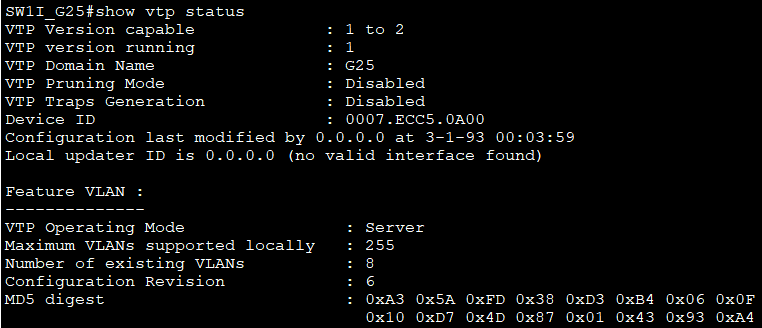

3. Propagación de VLAN en un cliente.
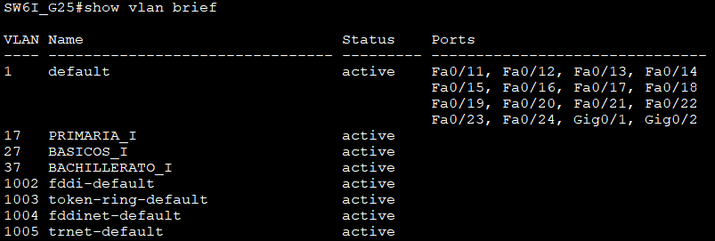

4. Interfaces trunk.
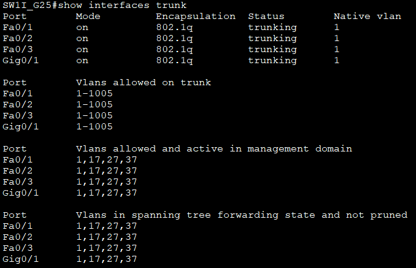

5. Tabla de VLAN.
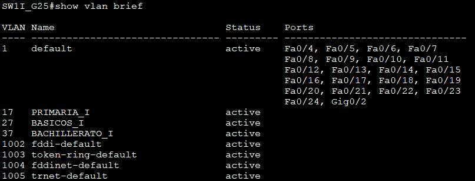

6. Estado de PVST y Rapid PVST.
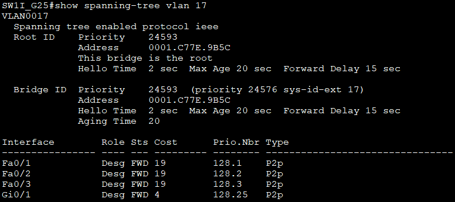
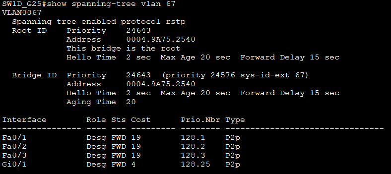

7. Pruebas de convergencia.
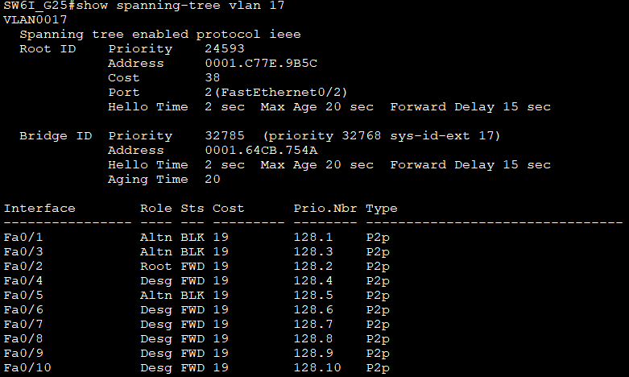
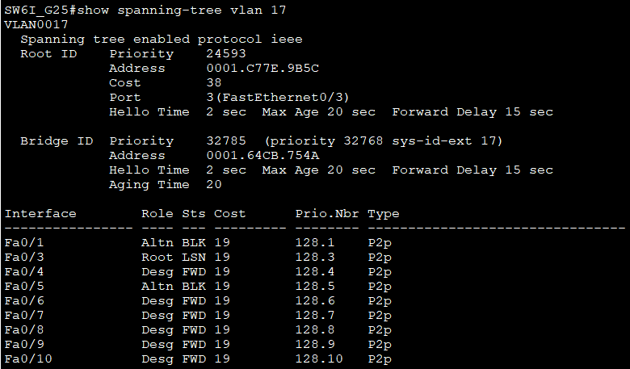

8. Port-security y violación de seguridad.
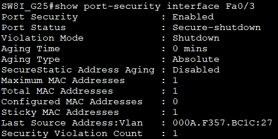
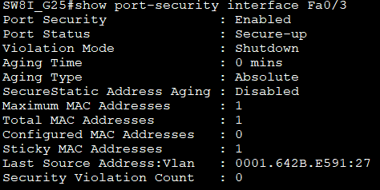
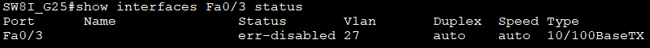

9. Tablas de enrutamiento.
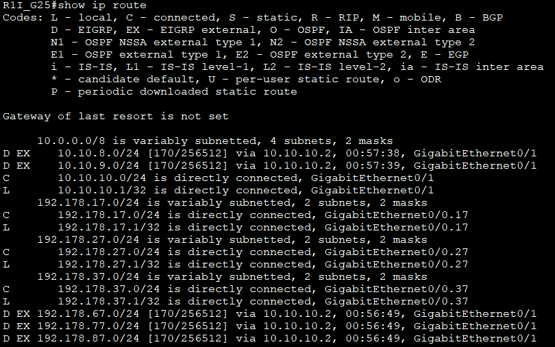
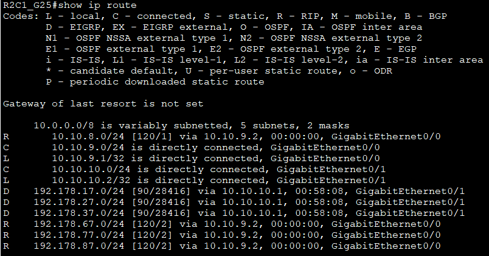
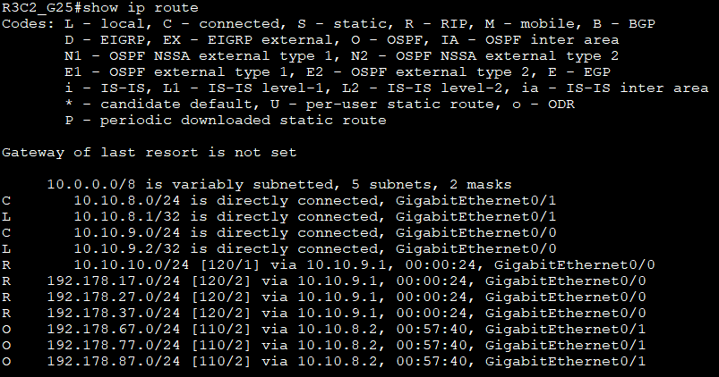
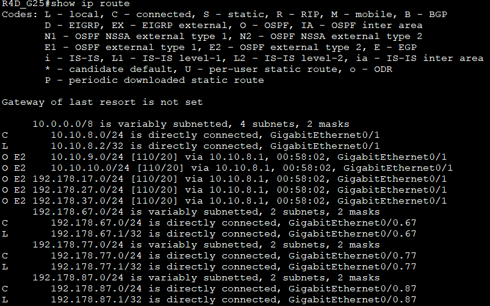

10. Vecinos EIGRP y OSPF.
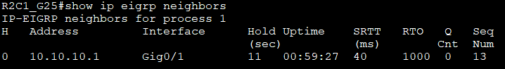
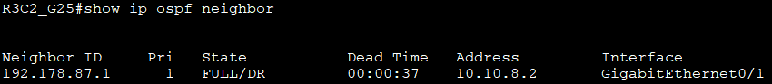

11. Pruebas de ping.
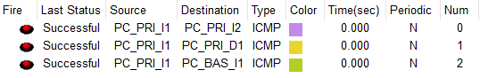
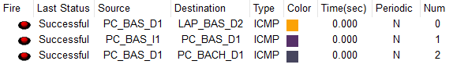
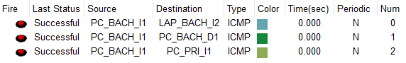

---

## 16. Conclusiones

1. La segmentación mediante VLANs junto con VTP demostró ser una solución eficiente para administrar centralizadamente una red de gran tamaño: al crear las VLAN únicamente en los switches servidor (`SW1I_G25` y `SW1D_G25`) y propagarlas automáticamente al resto de switches clientes mediante enlaces trunk, se evitó la necesidad de configurar manualmente cada uno de los 24 switches, reduciendo el margen de error y el tiempo de implementación.

2. La comparación práctica entre PVST y Rapid PVST confirmó la ventaja técnica de este último: mientras el edificio izquierdo (PVST) tardó aproximadamente 30 segundos en recuperar la conectividad tras la caída de un enlace redundante, el edificio derecho (Rapid PVST) convergió en apenas 2 segundos gracias al mecanismo de negociación propuesta/acuerdo. Esto evidencia que, en una red real como la del colegio Monte Alto, Rapid PVST es la opción más adecuada para minimizar interrupciones del servicio ante fallas físicas.

3. La combinación de EIGRP, RIP y OSPF con redistribución de rutas en los routers centrales permitió lograr conectividad de extremo a extremo entre ambos edificios sin necesidad de que todos los routers hablaran el mismo protocolo, resolviendo así el problema original de pérdida de paquetes reportado por el colegio. Las pruebas de ping exitosas entre VLAN del mismo edificio, entre edificios e inter-VLAN, sumadas al correcto funcionamiento de port-security, confirman que la topología quedó funcional, segura y alineada con los requerimientos técnicos de la práctica.

---
