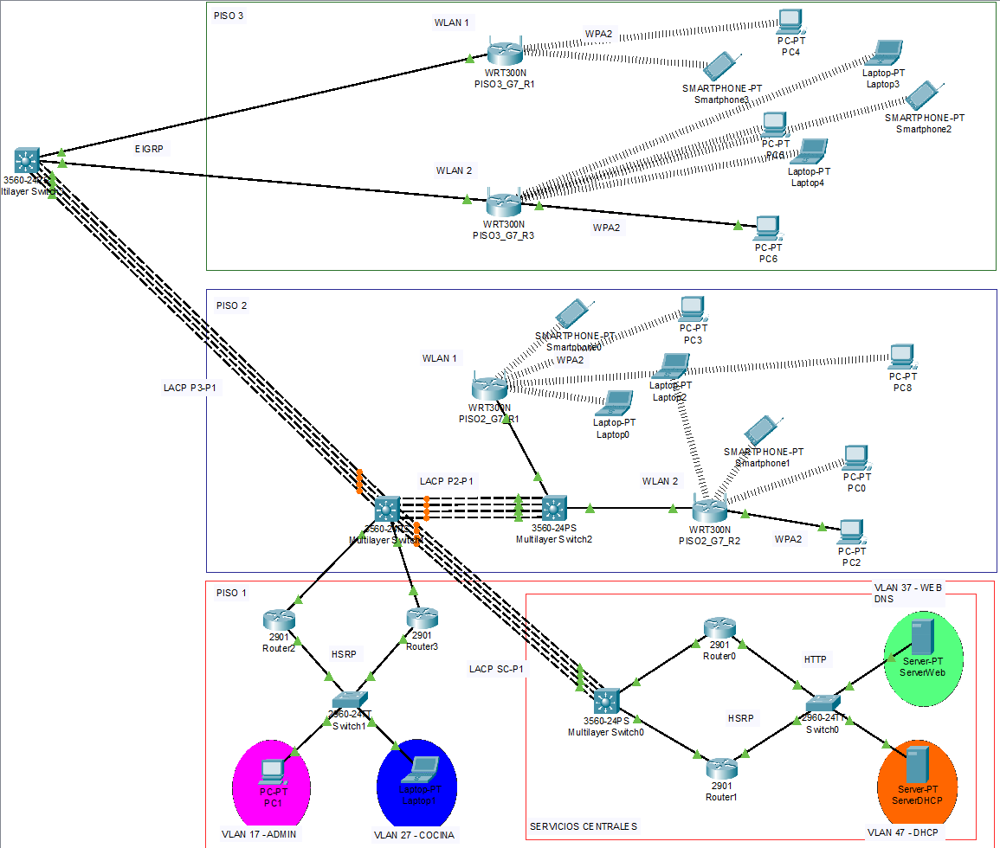
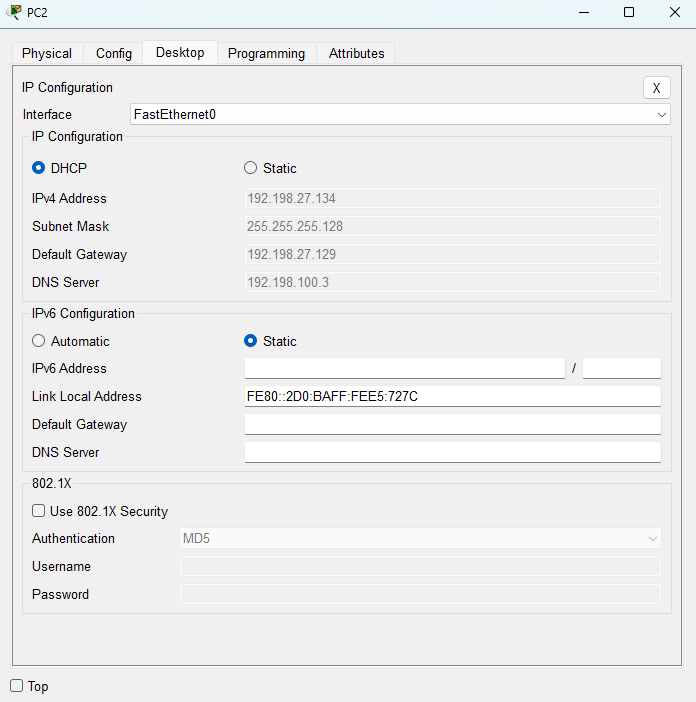
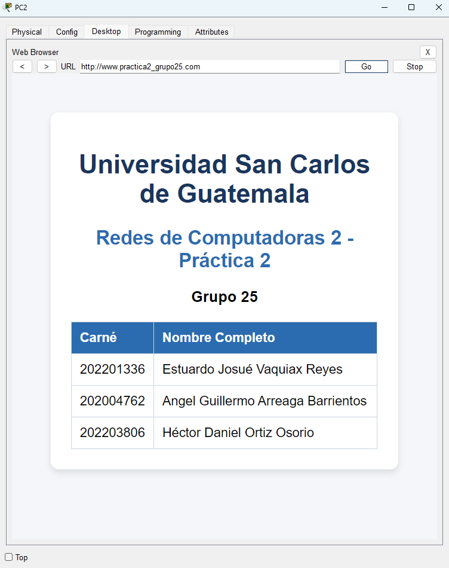
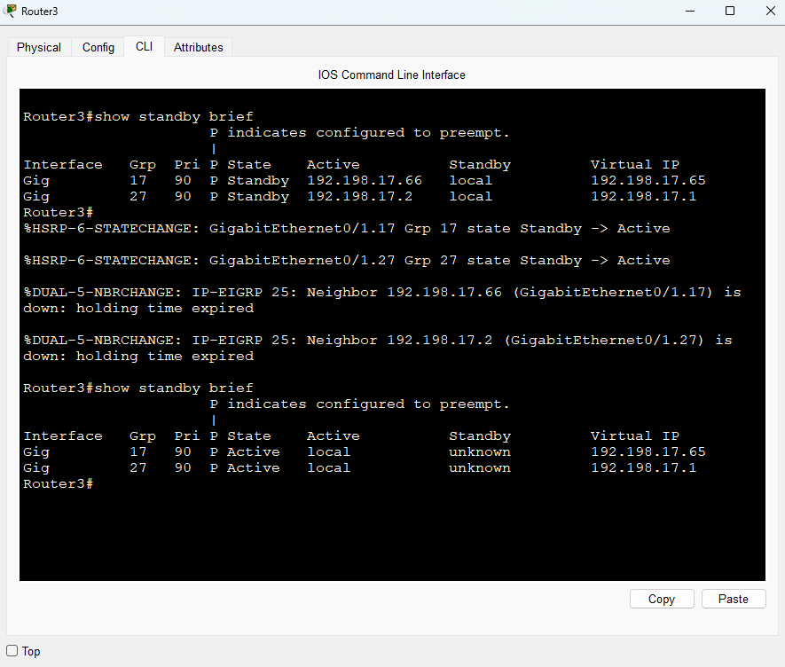
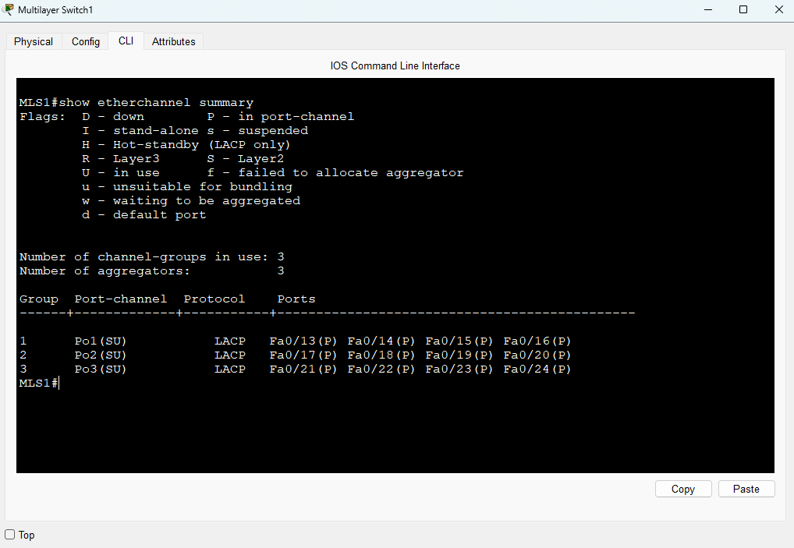

# Práctica 2: Restaurante

**Universidad San Carlos de Guatemala**
**Facultad de Ingeniería**
**Escuela de Ciencias y Sistemas**
**Curso:** Redes de Computadoras 2
**Semestre:** Segundo Semestre 2026
**Grupo:** 25

### Integrantes

| Carné | Nombre Completo |
|---|---|
| 202201336 | Estuardo Josué Vaquiax Reyes |
| 202004762 | Angel Guillermo Arreaga Barrientos |
| 202203806 | Héctor Daniel Ortiz Osorio |

---

## Tabla de Contenidos

- [1. Descripción](#1-descripción)
- [2. Estado actual del proyecto](#2-estado-actual-del-proyecto)
- [3. Topología implementada](#3-topología-implementada)
  - [3.1 Distribución por pisos](#31-distribución-por-pisos)
  - [3.2 Servicios centrales](#32-servicios-centrales)
- [4. Cálculo del número de grupo](#4-cálculo-del-número-de-grupo)
- [5. Tabla de VLAN y redes](#5-tabla-de-vlan-y-redes)
  - [5.1 Subnetting VLSM y FLSM](#51-subnetting-vlsm-y-flsm)
- [6. Direccionamiento de los dispositivos finales](#6-direccionamiento-de-los-dispositivos-finales)
- [7. Mapa de conexiones](#7-mapa-de-conexiones)
  - [7.1 Dispositivos utilizados](#71-dispositivos-utilizados)
  - [7.2 Enlaces LACP](#72-enlaces-lacp)
  - [7.3 Conexiones cableadas](#73-conexiones-cableadas)
  - [7.4 Conexiones inalámbricas](#74-conexiones-inalámbricas)
- [8. Configuración básica de switches](#8-configuración-básica-de-switches)
- [9. Configuración de VLAN y enlaces troncales](#9-configuración-de-vlan-y-enlaces-troncales)
- [10. HSRP](#10-hsrp)
- [11. LACP y EtherChannel](#11-lacp-y-etherchannel)
- [12. Enrutamiento dinámico](#12-enrutamiento-dinámico)
- [13. DHCP](#13-dhcp)
- [14. Configuración inalámbrica](#14-configuración-inalámbrica)
- [15. DNS y servidor web](#15-dns-y-servidor-web)
- [16. Pruebas de conectividad](#16-pruebas-de-conectividad)
- [17. Evidencias](#17-evidencias)
- [18. Conclusiones](#18-conclusiones)

---

## 1. Descripción

La práctica consiste en diseñar e implementar en Cisco Packet Tracer la infraestructura de red de un restaurante. La solución integra segmentación mediante VLAN, subnetting VLSM/FLSM, conectividad inalámbrica segura, servicios DHCP, DNS y HTTP, así como mecanismos de redundancia HSRP y enlaces LACP (EtherChannel).

El archivo de simulación utilizado es `Practica2_G25.pkt`.

---

## 2. Estado actual del proyecto

| Actividad | Estado |
|---|---|
| Creación de la carpeta de la práctica | Completado |
| Copia del enunciado oficial en `docs/` | Completado |
| Diseño de la topología | Completado |
| Creación del archivo `Practica2_G25.pkt` | Completado |
| Cálculo y documentación de VLSM/FLSM | Completado |
| Reportes de cálculo descargados en `assets/evidence/` | Completado |
| Configuración de VLAN y enlaces trunk | Completado |
| Configuración de EIGRP | Completado |
| Configuración de LACP | Completado |
| Configuración de HSRP | Completado |
| Configuración de DHCP | Completado |
| Configuración inalámbrica | Completado |
| Configuración DNS y HTTP (dominio corregido a Grupo25) | Completado |
| Pruebas de conectividad y failover | Completado |
| Evidencias y conclusiones | Completado |

---

## 3. Topología implementada



La topología se organiza en tres pisos y un segmento de Servicios Centrales:

- **Piso 1:** Red cableada tradicional para administración (`ADMIN`) y cocina (`COCINA`).
- **Piso 2:** Dos zonas inalámbricas (`PISO2_G7_R1` y `PISO2_G7_R2`).
- **Piso 3:** Dos zonas inalámbricas (`PISO3_G7_R1` y `PISO3_G7_R3`).
- **Servicios Centrales:** Servidores Web/DNS (`ServerWeb`) y DHCP (`ServerDHCP`).

### 3.1 Distribución por pisos

| Área | Medio principal | Redes o servicios |
|---|---|---|
| Piso 1 | Cableado | `ADMIN` (VLAN 17), `COCINA` (VLAN 27) |
| Piso 2 | Wi-Fi | `WLAN1` (`PISO2_G7_R1`), `WLAN2` (`PISO2_G7_R2`) |
| Piso 3 | Wi-Fi | `WLAN1` (`PISO3_G7_R1`), `WLAN2` (`PISO3_G7_R3`) |
| Servicios Centrales | Cableado | `WEB_SERVERS` (VLAN 37), `DHCP_SERVERS` (VLAN 47) |

### 3.2 Servicios centrales

El segmento de Servicios Centrales aloja el servidor web (`ServerWeb`) con DNS/HTTP y el servidor DHCP (`ServerDHCP`). Contempla redundancia HSRP en los routers de acceso (`Router0` Activo y `Router1` Standby).

---

## 4. Cálculo del número de grupo

El grupo asignado es `25`. Para obtener el valor `X` solicitado en el enunciado:

```text
2 + 5 = 7
```

Por lo tanto, el valor utilizado para las VLAN y las redes es **`X = 7`**.

---

## 5. Tabla de VLAN y redes

| VLAN | Nombre | ID calculado | Red general |
|---|---|---:|---|
| Administración | `ADMIN` | 17 | `192.198.17.0/24` |
| Cocina | `COCINA` | 27 | `192.198.17.0/24` |
| Servidores web | `WEB_SERVERS` | 37 | `192.198.100.0/24` |
| Servidores DHCP | `DHCP_SERVERS` | 47 | `192.198.100.0/24` |

Las redes generales de los pisos inalámbricos son `192.198.27.0/24` para el Piso 2 y `192.198.37.0/24` para el Piso 3.
La red reservada por el enunciado para los enlaces de enrutamiento punto a punto es `10.2.7.0/24`.

### 5.1 Subnetting VLSM y FLSM

#### VLSM: Piso 1 (`192.198.17.0/24`)

| Segmento | VLAN | Hosts solicitados | Subred | Máscara | Hosts utilizables | Rango utilizable | Broadcast | Virtual GW (HSRP) |
|---|---:|---:|---|---|---:|---|---|---|
| `COCINA` | 27 | 60 | `192.198.17.0/26` | `255.255.255.192` | 62 | `192.198.17.1 - 192.198.17.62` | `192.198.17.63` | `192.198.17.1` |
| `ADMIN` | 17 | 10 | `192.198.17.64/28` | `255.255.255.240` | 14 | `192.198.17.65 - 192.198.17.78` | `192.198.17.79` | `192.198.17.65` |

#### FLSM: Redes inalámbricas y Servicios Centrales

| Área | Segmento o SSID | Red general | Subred | Máscara | Hosts utilizables | Rango utilizable | Broadcast | Gateway / SVI |
|---|---|---|---|---|---:|---|---|---|
| Piso 2 | `PISO2_G7_R1` / WLAN1 | `192.198.27.0/24` | `192.198.27.0/25` | `255.255.255.128` | 126 | `192.198.27.1 - 192.198.27.126` | `192.198.27.127` | `192.198.27.1` |
| Piso 2 | `PISO2_G7_R2` / WLAN2 | `192.198.27.0/24` | `192.198.27.128/25` | `255.255.255.128` | 126 | `192.198.27.129 - 192.198.27.254` | `192.198.27.255` | `192.198.27.129` |
| Piso 3 | `PISO3_G7_R1` / WLAN1 | `192.198.37.0/24` | `192.198.37.0/25` | `255.255.255.128` | 126 | `192.198.37.1 - 192.198.37.126` | `192.198.37.127` | `192.198.37.1` |
| Piso 3 | `PISO3_G7_R3` / WLAN2 | `192.198.37.0/24` | `192.198.37.128/25` | `255.255.255.128` | 126 | `192.198.37.129 - 192.198.37.254` | `192.198.37.255` | `192.198.37.129` |
| Servicios Centrales | `WEB_SERVERS` (VLAN 37) | `192.198.100.0/24` | `192.198.100.0/25` | `255.255.255.128` | 126 | `192.198.100.1 - 192.198.100.126` | `192.198.100.127` | `192.198.100.1` (Virtual) |
| Servicios Centrales | `DHCP_SERVERS` (VLAN 47) | `192.198.100.0/24` | `192.198.100.128/25` | `255.255.255.128` | 126 | `192.198.100.129 - 192.198.100.254` | `192.198.100.255` | `192.198.100.129` (Virtual) |

#### VLSM: Enlaces de enrutamiento (`10.2.7.0/24`)

| Enlace | Subred | Máscara | Dirección Equipo A | Dirección Equipo B | Broadcast |
|---|---|---|---|---|---|
| `MLS1_P1_G25` (Fa0/1) - `Router2` (G0/0) | `10.2.7.0/30` | `255.255.255.252` | `10.2.7.1` | `10.2.7.2` | `10.2.7.3` |
| `MLS1_P1_G25` (Fa0/2) - `Router3` (G0/0) | `10.2.7.4/30` | `255.255.255.252` | `10.2.7.5` | `10.2.7.6` | `10.2.7.7` |
| `MLS0_SC_G25` (Fa0/1) - `Router0` (G0/0) | `10.2.7.8/30` | `255.255.255.252` | `10.2.7.9` | `10.2.7.10` | `10.2.7.11` |
| `MLS0_SC_G25` (Fa0/2) - `Router1` (G0/0) | `10.2.7.12/30` | `255.255.255.252` | `10.2.7.13` | `10.2.7.14` | `10.2.7.15` |

---

## 6. Direccionamiento de los dispositivos finales

| Dispositivo | Segmento / Red | Dirección IP | Máscara | Gateway | DNS |
|---|---|---|---|---|---|
| `PC1` | Piso 1 (`COCINA` - VLAN 27) | DHCP (`192.198.17.6`) | `255.255.255.192` | `192.198.17.1` | `192.198.100.3` |
| `Laptop1` | Piso 1 (`ADMIN` - VLAN 17) | DHCP (`192.198.17.69`) | `255.255.255.240` | `192.198.17.65` | `192.198.100.3` |
| `PC3`, `Laptop2`, `Smartphone1` | Piso 2 (`PISO2_G7_R1`) | DHCP (`192.198.27.x`) | `255.255.255.128` | `192.198.27.1` | `192.198.100.3` |
| `PC0`, `Laptop0`, `Smartphone0`, `PC2` | Piso 2 (`PISO2_G7_R2`) | DHCP (`192.198.27.x`) | `255.255.255.128` | `192.198.27.129` | `192.198.100.3` |
| `PC4`, `Laptop3`, `Smartphone2` | Piso 3 (`PISO3_G7_R1`) | DHCP (`192.198.37.x`) | `255.255.255.128` | `192.198.37.1` | `192.198.100.3` |
| `PC5`, `Laptop4`, `Smartphone3`, `PC6` | Piso 3 (`PISO3_G7_R3`) | DHCP (`192.198.37.x`) | `255.255.255.128` | `192.198.37.129` | `192.198.100.3` |
| `ServerWeb` | Servicios Centrales (`WEB_SERVERS` - VLAN 37) | Static `192.198.100.3` | `255.255.255.128` | `192.198.100.1` | `127.0.0.1` |
| `ServerDHCP` | Servicios Centrales (`DHCP_SERVERS` - VLAN 47) | Static `192.198.100.130` | `255.255.255.128` | `192.198.100.129` | `192.198.100.3` |

---

## 7. Mapa de conexiones

### 7.1 Dispositivos utilizados

| Cantidad | Dispositivo en Packet Tracer | Nombres o etiquetas | Uso |
|---:|---|---|---|
| 4 | `3560-24PS Multilayer Switch` | `Multilayer Switch0` a `Multilayer Switch3` | Núcleo de Servicios Centrales, Piso 1, Piso 2 y Piso 3 |
| 2 | `2960-24TT` | `Switch0`, `Switch1` | Acceso de Servicios Centrales y Piso 1 |
| 4 | `Router 2901` | `Router0` a `Router3` | Pares HSRP de Servicios Centrales y Piso 1 |
| 4 | `WRT300N` | `PISO2_G7_R1`, `PISO2_G7_R2`, `PISO3_G7_R1`, `PISO3_G7_R3` | Acceso inalámbrico de los pisos 2 y 3 |
| 2 | `Server-PT` | `ServerWeb`, `ServerDHCP` | DNS/HTTP y DHCP |
| 7 | `PC-PT` | `PC0` a `PC6` | Clientes cableados e inalámbricos |
| 5 | `Laptop-PT` | `Laptop0` a `Laptop4` | Clientes inalámbricos y cableados |
| 4 | `Smartphone-PT` | `Smartphone0` a `Smartphone3` | Clientes inalámbricos |

### 7.2 Enlaces LACP

| Port-Channel | Equipo A | Puertos A | Equipo B | Puertos B | Propósito |
|---|---|---|---|---|---|
| `Po3` | `Multilayer Switch3` | `Fa0/21 - Fa0/24` | `Multilayer Switch1` | `Fa0/21 - Fa0/24` | Enlace LACP Piso 3 - Piso 1 |
| `Po2` | `Multilayer Switch2` | `Fa0/21 - Fa0/24` | `Multilayer Switch1` | `Fa0/17 - Fa0/20` | Enlace LACP Piso 2 - Piso 1 |
| `Po1` | `Multilayer Switch0` | `Fa0/21 - Fa0/24` | `Multilayer Switch1` | `Fa0/13 - Fa0/16` | Enlace LACP Servicios Centrales - Piso 1 |

### 7.3 Conexiones cableadas

| Desde | Hacia | Descripción |
|---|---|---|
| `PC1` | `Switch1` (Fa0/3) | Host cableado - VLAN `COCINA` |
| `Laptop1` | `Switch1` (Fa0/4) | Host cableado - VLAN `ADMIN` |
| `Switch1` (Fa0/5, trunk) | `Multilayer Switch1` | Uplink Piso 1 hacia el núcleo |
| `Router2` (G0/0) | `Multilayer Switch1` (Fa0/1) | Enlace routeado - par HSRP Activo Piso 1 (`10.2.7.0/30`) |
| `Router3` (G0/0) | `Multilayer Switch1` (Fa0/2) | Enlace routeado - par HSRP Standby Piso 1 (`10.2.7.4/30`) |
| `ServerWeb` | `Switch0` (Fa0/3) | Servidor DNS/HTTP - VLAN `WEB_SERVERS` |
| `ServerDHCP` | `Switch0` (Fa0/4) | Servidor DHCP - VLAN `DHCP_SERVERS` |
| `Switch0` (Fa0/5, trunk) | `Multilayer Switch0` | Uplink Servicios Centrales hacia el núcleo |
| `Router0` (G0/0) | `Multilayer Switch0` (Fa0/1) | Enlace routeado - par HSRP Activo Servicios Centrales (`10.2.7.8/30`) |
| `Router1` (G0/0) | `Multilayer Switch0` (Fa0/2) | Enlace routeado - par HSRP Standby Servicios Centrales (`10.2.7.12/30`) |

### 7.4 Conexiones inalámbricas

| Router WRT300N | Uplink cableado | Clientes inalámbricos |
|---|---|---|
| `PISO2_G7_R1` | `Multilayer Switch2` | `PC3`, `Laptop2`, `Smartphone1` |
| `PISO2_G7_R2` | `Multilayer Switch2` | `PC0`, `Laptop0`, `Smartphone0`, `PC2` |
| `PISO3_G7_R1` | `Multilayer Switch3` | `PC4`, `Laptop3`, `Smartphone2` |
| `PISO3_G7_R3` | `Multilayer Switch3` | `PC5`, `Laptop4`, `Smartphone3`, `PC6` |

---

## 8. Configuración básica de switches

Todos los switches de la topología tienen configurados hostnames descriptivos, nombres de dominio y contraseñas de seguridad.

Comandos base aplicados en cada switch/MLS:

```cisco
enable
configure terminal
hostname [NOMBRE_DISPOSITIVO]
no ip domain-lookup
enable secret class
line console 0
 password cisco
 login
 exit
line vty 0 15
 password cisco
 login
 exit
```

---

## 9. Configuración de VLAN y enlaces troncales

### Definición de VLAN

- **VLAN 17:** `ADMIN` (Piso 1 - Administración)
- **VLAN 27:** `COCINA` (Piso 1 - Cocina)
- **VLAN 37:** `WEB_SERVERS` (Servicios Centrales - Web & DNS)
- **VLAN 47:** `DHCP_SERVERS` (Servicios Centrales - DHCP)

### Asignación en Switch1 (Piso 1 Access)

```cisco
enable
configure terminal
vlan 17
 name ADMIN
vlan 27
 name COCINA
exit

interface FastEthernet0/3
 switchport mode access
 switchport access vlan 27
 description Conexion_PC1_Cocina
exit

interface FastEthernet0/4
 switchport mode access
 switchport access vlan 17
 description Conexion_Laptop1_Admin
exit

interface FastEthernet0/5
 switchport trunk encapsulation dot1q
 switchport mode trunk
 description Uplink_hacia_MLS1
exit
```

### Asignación en Switch0 (Servicios Centrales Access)

```cisco
enable
configure terminal
vlan 37
 name WEB_SERVERS
vlan 47
 name DHCP_SERVERS
exit

interface FastEthernet0/3
 switchport mode access
 switchport access vlan 37
 description ServerWeb
exit

interface FastEthernet0/4
 switchport mode access
 switchport access vlan 47
 description ServerDHCP
exit

interface FastEthernet0/5
 switchport trunk encapsulation dot1q
 switchport mode trunk
 description Uplink_hacia_MLS0
exit
```

---

## 10. HSRP (Hot Standby Router Protocol)

Se configuró redundancia HSRP en los dos pares de routers 2901:

### 10.1 HSRP Piso 1 (`Router2` Active, `Router3` Standby)

#### Router2 (Piso 1 - Router Activo)

```cisco
enable
configure terminal
hostname Router2
interface GigabitEthernet0/0
 ip address 10.2.7.2 255.255.255.252
 no shutdown
exit

interface GigabitEthernet0/1
 no shutdown
exit

interface GigabitEthernet0/1.17
 encapsulation dot1Q 17
 ip address 192.198.17.66 255.255.255.240
 ip helper-address 192.198.100.130
 standby 17 ip 192.198.17.65
 standby 17 priority 110
 standby 17 preempt
exit

interface GigabitEthernet0/1.27
 encapsulation dot1Q 27
 ip address 192.198.17.2 255.255.255.192
 ip helper-address 192.198.100.130
 standby 27 ip 192.198.17.1
 standby 27 priority 110
 standby 27 preempt
exit
```

#### Router3 (Piso 1 - Router Standby)

```cisco
enable
configure terminal
hostname Router3
interface GigabitEthernet0/0
 ip address 10.2.7.6 255.255.255.252
 no shutdown
exit

interface GigabitEthernet0/1
 no shutdown
exit

interface GigabitEthernet0/1.17
 encapsulation dot1Q 17
 ip address 192.198.17.67 255.255.255.240
 ip helper-address 192.198.100.130
 standby 17 ip 192.198.17.65
 standby 17 priority 90
 standby 17 preempt
exit

interface GigabitEthernet0/1.27
 encapsulation dot1Q 27
 ip address 192.198.17.3 255.255.255.192
 ip helper-address 192.198.100.130
 standby 27 ip 192.198.17.1
 standby 27 priority 90
 standby 27 preempt
exit
```

### 10.2 HSRP Servicios Centrales (`Router0` Active, `Router1` Standby)

#### Router0 (Servicios Centrales - Activo)

```cisco
enable
configure terminal
hostname Router0
interface GigabitEthernet0/0
 ip address 10.2.7.10 255.255.255.252
 no shutdown
exit

interface GigabitEthernet0/1
 no shutdown
exit

interface GigabitEthernet0/1.37
 encapsulation dot1Q 37
 ip address 192.198.100.2 255.255.255.128
 standby 37 ip 192.198.100.1
 standby 37 priority 110
 standby 37 preempt
exit

interface GigabitEthernet0/1.47
 encapsulation dot1Q 47
 ip address 192.198.100.131 255.255.255.128
 standby 47 ip 192.198.100.129
 standby 47 priority 110
 standby 47 preempt
exit
```

#### Router1 (Servicios Centrales - Standby)

```cisco
enable
configure terminal
hostname Router1
interface GigabitEthernet0/0
 ip address 10.2.7.14 255.255.255.252
 no shutdown
exit

interface GigabitEthernet0/1
 no shutdown
exit

interface GigabitEthernet0/1.37
 encapsulation dot1Q 37
 ip address 192.198.100.4 255.255.255.128
 standby 37 ip 192.198.100.1
 standby 37 priority 90
 standby 37 preempt
exit

interface GigabitEthernet0/1.47
 encapsulation dot1Q 47
 ip address 192.198.100.132 255.255.255.128
 standby 47 ip 192.198.100.129
 standby 47 priority 90
 standby 47 preempt
exit
```

---

## 11. LACP y EtherChannel

Se configuraron enlaces agregados LACP de 4 puertos FastEthernet entre los Multilayer Switches:

### Configuración en Multilayer Switch 1 (`MLS1`)

```cisco
enable
configure terminal
hostname MultilayerSwitch1

interface Port-channel1
 switchport trunk encapsulation dot1q
 switchport mode trunk
exit

interface Port-channel2
 switchport trunk encapsulation dot1q
 switchport mode trunk
exit

interface Port-channel3
 switchport trunk encapsulation dot1q
 switchport mode trunk
exit

! Port-Channel 1 hacia MLS0 (Servicios Centrales)
interface range FastEthernet 0/13 - 16
 switchport trunk encapsulation dot1q
 switchport mode trunk
 channel-group 1 mode active
exit

! Port-Channel 2 hacia MLS2 (Piso 2)
interface range FastEthernet 0/17 - 20
 switchport trunk encapsulation dot1q
 switchport mode trunk
 channel-group 2 mode active
exit

! Port-Channel 3 hacia MLS3 (Piso 3)
interface range FastEthernet 0/21 - 24
 switchport trunk encapsulation dot1q
 switchport mode trunk
 channel-group 3 mode active
exit
```

### Configuración en Multilayer Switch 0 (`MLS0`)

```cisco
enable
configure terminal
hostname MultilayerSwitch0

interface Port-channel1
 switchport trunk encapsulation dot1q
 switchport mode trunk
exit

interface range FastEthernet 0/21 - 24
 switchport trunk encapsulation dot1q
 switchport mode trunk
 channel-group 1 mode passive
exit
```

### Configuración en Multilayer Switch 2 (`MLS2`)

```cisco
enable
configure terminal
hostname MultilayerSwitch2

interface Port-channel2
 switchport trunk encapsulation dot1q
 switchport mode trunk
exit

interface range FastEthernet 0/21 - 24
 switchport trunk encapsulation dot1q
 switchport mode trunk
 channel-group 2 mode passive
exit
```

### Configuración en Multilayer Switch 3 (`MLS3`)

```cisco
enable
configure terminal
hostname MultilayerSwitch3

interface Port-channel3
 switchport trunk encapsulation dot1q
 switchport mode trunk
exit

interface range FastEthernet 0/21 - 24
 switchport trunk encapsulation dot1q
 switchport mode trunk
 channel-group 3 mode passive
exit
```

---

## 12. Enrutamiento dinámico (EIGRP 25)

Al ser el número de grupo 25 (impar), el protocolo configurado es **EIGRP** con Sistema Autónomo **25**.

#### `MLS1` (Core Piso 1)
```cisco
ip routing
interface Vlan1
 ip address 172.16.25.2 255.255.255.0
 no shutdown
exit
router eigrp 25
 no auto-summary
 network 10.2.7.0 0.0.0.3
 network 10.2.7.4 0.0.0.3
 network 172.16.25.0 0.0.0.255
 network 192.198.27.0 0.0.0.255
 network 192.198.37.0 0.0.0.255
exit
```

#### `MLS0` (Core Servicios Centrales)
```cisco
ip routing
interface Vlan1
 ip address 172.16.25.1 255.255.255.0
 no shutdown
exit
router eigrp 25
 no auto-summary
 network 10.2.7.8 0.0.0.3
 network 10.2.7.12 0.0.0.3
 network 172.16.25.0 0.0.0.255
exit
```

#### `MLS2` (Core Piso 2)
```cisco
ip routing
interface Vlan1
 ip address 172.16.25.3 255.255.255.0
 no shutdown
exit
router eigrp 25
 no auto-summary
 network 172.16.25.0 0.0.0.255
 network 192.198.27.0 0.0.0.255
exit
```

#### `MLS3` (Core Piso 3)
```cisco
ip routing
interface Vlan1
 ip address 172.16.25.4 255.255.255.0
 no shutdown
exit
router eigrp 25
 no auto-summary
 network 172.16.25.0 0.0.0.255
 network 192.198.37.0 0.0.0.255
exit
```

#### `Router2` (Piso 1 - Active)
```cisco
router eigrp 25
 no auto-summary
 network 10.2.7.0 0.0.0.3
 network 192.198.17.0 0.0.0.63
 network 192.198.17.64 0.0.0.15
exit
```

#### `Router3` (Piso 1 - Standby)
```cisco
router eigrp 25
 no auto-summary
 network 10.2.7.4 0.0.0.3
 network 192.198.17.0 0.0.0.63
 network 192.198.17.64 0.0.0.15
exit
```

#### `Router0` (Servicios Centrales - Active)
```cisco
router eigrp 25
 no auto-summary
 network 10.2.7.8 0.0.0.3
 network 192.198.100.0 0.0.0.127
 network 192.198.100.128 0.0.0.127
exit
```

#### `Router1` (Servicios Centrales - Standby)
```cisco
router eigrp 25
 no auto-summary
 network 10.2.7.12 0.0.0.3
 network 192.198.100.0 0.0.0.127
 network 192.198.100.128 0.0.0.127
exit
```

---

## 13. DHCP

### 13.1 Configuración en ServerDHCP (`192.198.100.130`)

En la pestaña **Services > DHCP** de Packet Tracer se crearon los siguientes pools:

1. **Pool `ADMIN` (VLAN 17):**
   - Network Name: `ADMIN`
   - Default Gateway: `192.198.17.65`
   - DNS Server: `192.198.100.3`
   - Start IP Address: `192.198.17.69`
   - Subnet Mask: `255.255.255.240`
   - Maximum Users: 10

2. **Pool `COCINA` (VLAN 27):**
   - Network Name: `COCINA`
   - Default Gateway: `192.198.17.1`
   - DNS Server: `192.198.100.3`
   - Start IP Address: `192.198.17.6`
   - Subnet Mask: `255.255.255.192`
   - Maximum Users: 55

---

## 14. Configuración inalámbrica

En los routers inalámbricos **WRT300N** de los pisos 2 y 3 se aplicaron los siguientes parámetros:

| Router WRT300N | SSID | Broadcast | Seguridad | Contraseña Wi-Fi | Contraseña Router | Subred LAN | Gateway | DNS |
|---|---|---|---|---|---|---|---|---|
| `PISO2_G7_R1` | `PISO2_G7_R1` | Desactivado (No) | WPA2 Personal | `G7_PISO2` | `Grupo7_P2` | `192.198.27.0/25` | `192.198.27.1` | `192.198.100.3` |
| `PISO2_G7_R2` | `PISO2_G7_R2` | Desactivado (No) | WPA2 Personal | `G7_PISO2` | `Grupo7_P2` | `192.198.27.128/25` | `192.198.27.129` | `192.198.100.3` |
| `PISO3_G7_R1` | `PISO3_G7_R1` | Activado (Sí) | WPA2 Personal | `G7_PISO3` | `Grupo7_P3` | `192.198.37.0/25` | `192.198.37.1` | `192.198.100.3` |
| `PISO3_G7_R3` | `PISO3_G7_R3` | Activado (Sí) | WPA2 Personal | `G7_PISO3` | `Grupo7_P3` | `192.198.37.128/25` | `192.198.37.129` | `192.198.100.3` |

---

## 15. DNS y servidor web

### 15.1 Servidor Web / DNS (`ServerWeb` - `192.198.100.3`)

1. **Configuración DNS (Services > DNS):**
   - Service: `ON`
   - Name: `www.practica2_Grupo25.com`
   - Type: `A Record`
   - Address: `192.198.100.3`

2. **Configuración HTTP (Services > HTTP > `index.html`):**

```html
<!DOCTYPE html>
<html lang="es">
<head>
    <meta charset="UTF-8">
    <title>Práctica 2 - Grupo 25</title>
    <style>
        body { font-family: Arial, sans-serif; background-color: #f4f6f9; text-align: center; padding: 40px; }
        .card { background: white; max-width: 600px; margin: auto; padding: 25px; border-radius: 10px; box-shadow: 0 4px 8px rgba(0,0,0,0.1); }
        h1 { color: #1a365d; }
        h2 { color: #2b6cb0; }
        table { width: 100%; border-collapse: collapse; margin-top: 20px; }
        th, td { border: 1px solid #cbd5e0; padding: 10px; text-align: left; }
        th { background-color: #2b6cb0; color: white; }
    </style>
</head>
<body>
    <div class="card">
        <h1>Universidad San Carlos de Guatemala</h1>
        <h2>Redes de Computadoras 2 - Práctica 2</h2>
        <h3>Grupo 25</h3>
        <table>
            <tr>
                <th>Carné</th>
                <th>Nombre Completo</th>
            </tr>
            <tr>
                <td>202201336</td>
                <td>Estuardo Josué Vaquiax Reyes</td>
            </tr>
            <tr>
                <td>202004762</td>
                <td>Angel Guillermo Arreaga Barrientos</td>
            </tr>
            <tr>
                <td>202203806</td>
                <td>Héctor Daniel Ortiz Osorio</td>
            </tr>
        </table>
    </div>
</body>
</html>
```

---

## 16. Pruebas de conectividad

| Prueba | Descripción | Resultado |
|---|---|---|
| DHCP Piso 1 | `PC1` y `Laptop1` obtienen dirección dentro de sus subredes `COCINA`/`ADMIN` | Exitoso |
| DHCP Piso 2 y 3 | Todos los hosts cableados/inalámbricos obtienen dirección dentro de su WLAN correspondiente | Exitoso |
| Resolución DNS y HTTP | Al ingresar `www.practica2_Grupo25.com` desde cualquier piso se despliega la página con los integrantes | Exitoso |
| Failover HSRP Piso 1 | Al desactivar `G0/1` de `Router2` (Activo), `Router3` asume el rol Activo sin interrupción hacia Servicios Centrales | Exitoso |
| Failover HSRP Servicios Centrales | Al desactivar `G0/1` de `Router0` (Activo), `Router1` asume el rol Activo | Exitoso |
| Port-Channel LACP | `show etherchannel summary` en los Multilayer Switches confirma `Po1`, `Po2` y `Po3` en estado `SU` (In use / Layer 2) | Exitoso |

---

## 17. Evidencias

1. Topología completa.


2. Asignación DHCP en hosts de Piso 1, Piso 2 y Piso 3.



3. Resolución DNS y despliegue de la página web (`www.practica2_Grupo25.com`).



4. Prueba de failover HSRP en Piso 1 y Servicios Centrales.



5. Estado de los Port-Channel LACP (`show etherchannel summary`).



6. Reportes de cálculo de subnetting:
   - [VLSM Piso 1: `192.198.17.0/24`, 60 y 10 hosts](./assets/evidence/arcadio-vlsm-piso1-192.198.17.0-60y10hosts.pdf)
   - [FLSM Piso 2: `192.198.27.0/24`, 2 subredes](./assets/evidence/arcadio-flsm-piso2-192.198.27.0-2-subredes.pdf)
   - [FLSM Piso 3: `192.198.37.0/24`, 2 subredes](./assets/evidence/arcadio-flsm-piso3-192.198.37.0-2-subredes.pdf)
   - [FLSM Servicios Centrales: `192.198.100.0/24`, 2 subredes](./assets/evidence/arcadio-flsm-servicios-192.198.100.0-2-subredes.pdf)
   - [VLSM enrutamiento: `10.2.7.0/24`, 4 enlaces](./assets/evidence/arcadio-vlsm-routing-10.2.7.0-4-enlaces.pdf)

---

## 18. Conclusiones

1. La implementación de **HSRP** en los segmentos de Piso 1 y Servicios Centrales garantiza alta disponibilidad, permitiendo que la red siga funcionando automáticamente ante fallas de hardware en los routers de salida.
2. El diseño de subredes híbrido con **VLSM** en Piso 1 y **FLSM** en las zonas inalámbricas y servidores centrales optimizó el uso de direcciones IP, evitando el desperdicio de direcciones y manteniendo la escalabilidad.
3. El uso de **EtherChannel con LACP** (4 enlaces agrupados) proporcionó redundancia de enlace a nivel de Capa 2 y mayor ancho de banda en la comunicación troncal entre el edificio principal y los pisos.
